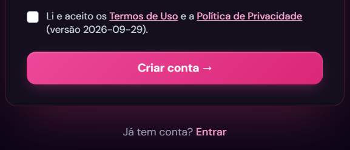
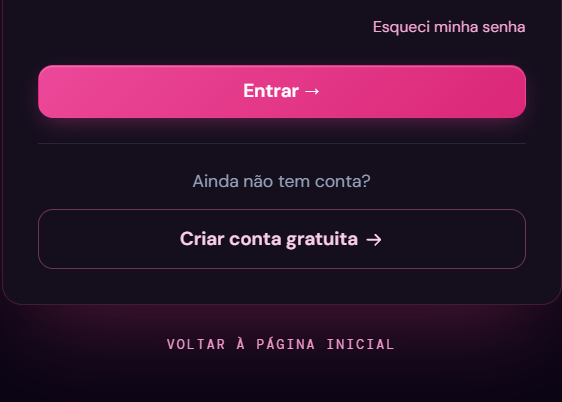
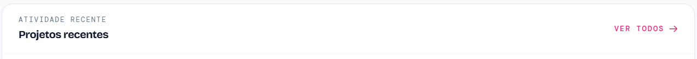
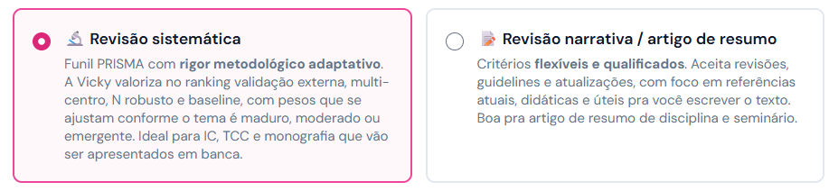
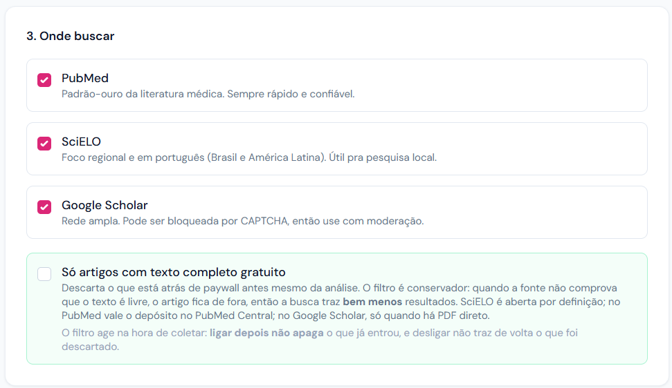
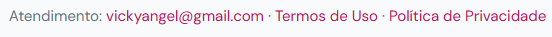
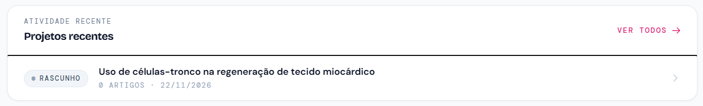

# M2.6.1 Teste só com teclado: ficha de K1

> Roteiro, caminho de cada função e critério de sucesso: [Método do G2 com usuários](../../../../docs/fase-3/metodo-g2-usuarios.md), seção 4.2. nao abra a ficha do outro avaliador nem o `consolidado.md` antes de enviar esta.
>
> **Como preencher pelo GitHub:** abra este arquivo, clique no lápis (_Edit this file_), escreva entre as barras `|` de cada linha e clique em _Commit changes_. As capturas vão para `evidencias/`, com o nome `AAAAMMDD_T1_<funcao>_<passo>.png`.

| Campo                        | Valor         |
| ---------------------------- | ------------- |
| Avaliador                    | K1            |
| Data da coleta               | 22-23/11/2026 |
| Hora de início e de fim      | 21:50 / --:-- |
| Versão do Chrome             | 158.0.8127.37 |
| Mouse e trackpad desativados |               |

Uma linha por função. Se a função falhar, descreva o passo e o motivo em `onde_falhou`. Em `concluida`, use `sim`, `nao` ou `nao_coletado`. F05 só é preenchida por quem executou a triagem com o teclado.

| funcao | nome               | acionavel | foco_visivel | alvos_abaixo_de_24px                                                                                                                                                                                                                                                                                                                                                                                 | excecao_2_5_8                                                                                                                                                                                                                                                             | onde_falhou                                                                                         | concluida    |
| ------ | ------------------ | --------- | ------------ | ---------------------------------------------------------------------------------------------------------------------------------------------------------------------------------------------------------------------------------------------------------------------------------------------------------------------------------------------------------------------------------------------------- | ------------------------------------------------------------------------------------------------------------------------------------------------------------------------------------------------------------------------------------------------------------------------- | --------------------------------------------------------------------------------------------------- | ------------ |
| F01    | Cadastro e login   | sim       | sim          | Em `signup`: _Checkbox_ de aceitação dos Termos de Uso e Política de Privacidade (14.4 x 14.4) e _links_ aos Termos de Uso (90.475 x 16.8), à Política de Privacidade (139.025 x 16.8) e à página de _login_ (40.388 x 17.6); em `login`: Botões "Esqueci minha senha" (122.037 x 16) e "Voltar à Página Inicial" (183.487 x 13.6); em `esqueci-senha`: botão "Voltar para o login" (151.575 x 13.6) | _Links_ de Termos, Política e _Login_ em `signup` estão dentro de frase, então vale a exceção de link em frase. Além disso, todos os alvos que falharam no requisito de tamanho respeitam o limite de pelo menos 24 px de distância de outros elementos (alvos) focáveis. |                                                                                                     | sim          |
| F02    | Criação de projeto | sim       | nao          | Botão "Ver Todos" em `dashboard` (93.262 x 16.5), botão "Voltar" em `projetos/novo` (61.163 x 20), 2 botões de rádio e 4 _checkboxes_ em `projetos/novo` (16 x 16), e _links_ do _e-mail_ de atendimento (126.363 x 16), Termos de Uso (82.475 x 16) e Política de Privacidade (125.75 x 16) em ambas as páginas                                                                                     | Todos os alvos que falharam no requisito de tamanho respeitam o limite de pelo menos 24 px de distância de outros elementos (alvos) focáveis.                                                                                                                             | Um foco ficou apenas parcialmente invisível em `dashboard`, aparecendo somente o seu lado superior. | nao          |
| F03    | Geração do PICO    | sim       |              |                                                                                                                                                                                                                                                                                                                                                                                                      |                                                                                                                                                                                                                                                                           |                                                                                                     | nao_coletado |
| F04    | Bases e quantidade |           |              |                                                                                                                                                                                                                                                                                                                                                                                                      |                                                                                                                                                                                                                                                                           |                                                                                                     | nao_coletado |
| F05    | Triagem completa   |           |              |                                                                                                                                                                                                                                                                                                                                                                                                      |                                                                                                                                                                                                                                                                           |                                                                                                     | nao_coletado |
| F06    | Lista ranqueada    |           |              |                                                                                                                                                                                                                                                                                                                                                                                                      |                                                                                                                                                                                                                                                                           |                                                                                                     | nao_coletado |
| F07    | Favoritos          |           |              |                                                                                                                                                                                                                                                                                                                                                                                                      |                                                                                                                                                                                                                                                                           |                                                                                                     | nao_coletado |
| F08    | Log auditável      |           |              |                                                                                                                                                                                                                                                                                                                                                                                                      |                                                                                                                                                                                                                                                                           |                                                                                                     | nao_coletado |
| F09    | Exportação         |           |              |                                                                                                                                                                                                                                                                                                                                                                                                      |                                                                                                                                                                                                                                                                           |                                                                                                     | nao_coletado |

Capturas citadas:

- F01:

  
  
  

- F02:

