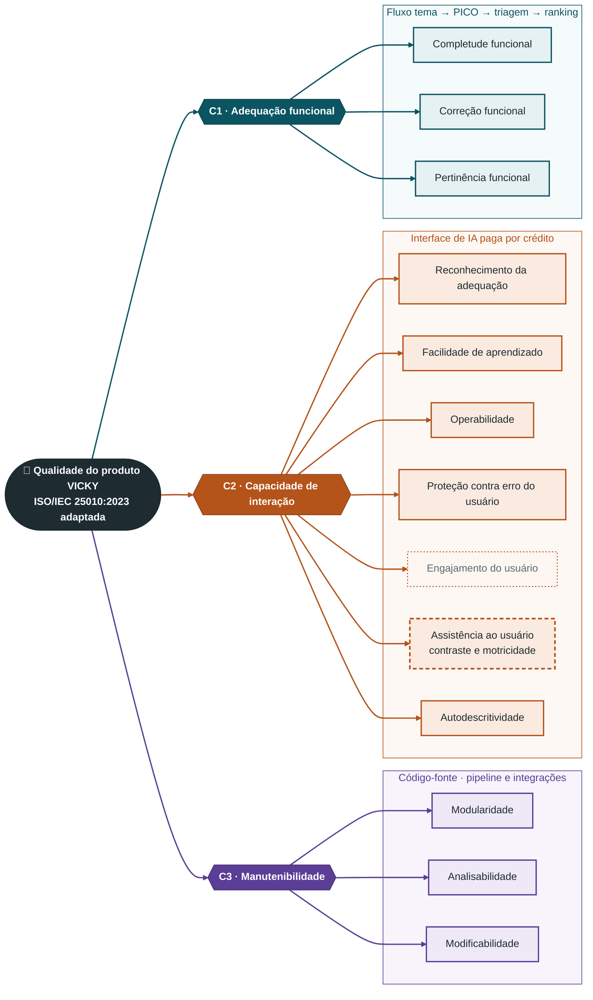

# Modelo de qualidade

## 1. Norma de referência

O modelo de referência é o modelo de qualidade do produto da **ISO/IEC 25010:2023** (família SQuaRE - ISO/IEC 25000). A terminologia segue a edição de 2023, em que "usabilidade" passou a se chamar **capacidade de interação**.

!!! note "Modelo adaptado"
    A equipe não aplica a norma na íntegra. Usamos um **recorte da ISO/IEC 25010:2023 adaptado ao VICKY**, com apenas as características e subcaracterísticas necessárias ao [propósito da avaliação](proposito.md). O significado de cada subcaracterística foi ajustado ao contexto do produto: uma plataforma web de triagem de literatura científica com IA, usada por estudantes de medicina. Os motivos da escolha das três características estão em [Seleção e priorização das características](caracteristicas.md). Esta página descreve **como** cada uma foi adaptada.

## 2. Adaptação ao VICKY

### 2.1 Adequação funcional (C1)

No VICKY, a adequação funcional fica concentrada no fluxo principal, que vai do **tema ao PICO, à triagem por IA e à lista ranqueada**. As funções de apoio, como pagamento e configurações, não são o foco. O resultado vem de modelos de linguagem e de bases externas, então "funcionar" significa **entregar a evidência certa ao estudante**, não só concluir a execução sem erro.

| Subcaracterística | Definição (ISO/IEC 25010:2023) | Adaptação ao VICKY |
|-------------------|--------------------------------|--------------------|
| Completude funcional | Grau em que o conjunto de funções cobre todas as tarefas e objetivos especificados | Comparar o que o estudante precisa para iniciar uma revisão (protocolo PICO, critérios de inclusão e exclusão, busca nas bases, lista ranqueada, links, log auditável e exportação) com o que o VICKY de fato entrega |
| Correção funcional | Grau em que o produto fornece resultados precisos quando usado pelos usuários-alvo | Verificar se o resultado da IA, principal função do produto, está correto: os artigos incluídos respeitam o PICO e os filtros configurados, os metadados e links estão certos e o resultado responde à expectativa final do estudante |
| Pertinência funcional | Grau em que as funções facilitam a realização das tarefas e objetivos especificados | Verificar se a lista entregue é **útil** ao estudante de medicina, ou seja, se o ranking por Quality Score e os recortes ajudam a começar a IC, o TCC ou a monografia sem uma nova triagem manual |

### 2.2 Capacidade de interação (C2)

A interação no VICKY tem duas particularidades. O usuário precisa entender **conceitos metodológicos** (PICO, revisão sistemática ou narrativa, Quality Score) e opera uma **interface de IA paga por crédito**, em que um erro de configuração custa dinheiro e tempo. A adaptação, por isso, privilegia a compreensão do fluxo e a prevenção de erros, e não a estética.

| Subcaracterística | Definição (ISO/IEC 25010:2023) | Adaptação ao VICKY |
|-------------------|--------------------------------|--------------------|
| Reconhecimento da adequação | Grau em que os usuários reconhecem se o produto é adequado às suas necessidades | Verificar se o estudante, ao abrir o site, entende para que o VICKY serve (triagem de artigos para IC, TCC e monografia) e o que ele não faz (não substitui a leitura crítica), antes de criar conta |
| Facilidade de aprendizado | Grau em que usuários-alvo aprendem a usar o produto com eficácia em tempo determinado | Verificar se um estudante sem formação em metodologia consegue concluir o primeiro projeto (tema → PICO → triagem) sem ajuda externa. A prévia gratuita do PICO é o principal ponto de aprendizado |
| Operabilidade | Grau em que o produto tem atributos que o tornam fácil de operar e controlar | Adaptada ao **uso recorrente** em pesquisa: criar vários projetos, reabrir resultados anteriores, refazer a triagem com outros recortes e saber o saldo de créditos antes de executar. O VICKY não usa assinatura; o uso contínuo é medido pelo consumo de créditos avulsos |
| Proteção contra erro do usuário | Grau em que o sistema impede que o usuário cometa erros | Ponto crítico por causa da interface de IA: tema vago, recortes contraditórios ou seleção errada de bases geram uma triagem ruim e consomem um crédito. Avaliar se o sistema valida, alerta e pede confirmação antes de executar |
| Engajamento do usuário | Grau em que a interface apresenta funções e informações de modo convidativo e motivador | Mantida com **prioridade secundária**: a aparência e a identidade visual (cores, contraste e tipografia) influenciam a satisfação, mas não definem se o estudante consegue concluir a tarefa |
| Assistência ao usuário | Grau em que o produto pode ser usado por pessoas com a mais ampla gama de características e capacidades | **Adaptada com escopo reduzido**: analisamos principalmente o *contraste* e o suporte a pessoas com *dificuldade motora* (navegação por teclado, tamanho dos alvos de clique). Não revisamos o suporte a pessoas cegas, surdas ou com outras deficiências, por causa do perfil do público-alvo e da natureza restrita da aplicação |
| Autodescritividade | Grau em que o produto apresenta as informações necessárias para que seu uso seja imediatamente óbvio, sem consulta externa | O VICKY usa termos técnicos (PICO, Quality Score, modo sistemática ou narrativa, crédito, *double-check*) e promete que o usuário não precisa saber montar um PICO. Avaliar se menus, rótulos e instruções explicam esses termos na própria tela e deixam claro o que cada ação faz e o que consome crédito |

### 2.3 Manutenibilidade (C3)

A manutenibilidade é avaliada internamente pelo código-fonte liberado pela equipe do VICKY. 

A adaptação considera a arquitetura do produto: um orquestrador de *pipeline* (`pipeline.py`) que integra serviços externos instáveis por natureza (bases científicas, provedores de LLM e pagamento).

O foco é saber se o sistema consegue evoluir, com novas fontes, novos prompts e novos provedores, sem efeitos colaterais ou quebrar tudo.

| Subcaracterística | Definição (ISO/IEC 25010:2023) | Adaptação ao VICKY |
|-------------------|--------------------------------|--------------------|
| Modularidade | Grau em que o sistema é composto de componentes separados, de modo que a alteração de um tenha impacto mínimo nos demais | Verificar se o VICKY pode *se expandir* (adicionar uma base científica, trocar o provedor de LLM, mudar o pagamento) com alterações isoladas no módulo correspondente, sem quebrar o restante da aplicação |
| Analisabilidade | Grau de eficácia e eficiência em avaliar o impacto de uma mudança ou diagnosticar falhas e suas causas | Verificar se o repositório é simples de entender e *bem documentado*: estrutura clara, nomes significativos, documentação e *logs* que permitam localizar a origem de uma falha no *pipeline* |
| Modificabilidade | Grau em que o produto pode ser modificado sem introduzir defeitos ou degradar a qualidade | Mesma perspectiva da analisabilidade, voltada à mudança: verificar se ajustes recorrentes (prompts, regras do Quality Score, critérios de triagem) podem ser feitos com segurança e baixo acoplamento |

### 2.4 O que ficou de fora do modelo

| Elemento da ISO/IEC 25010:2023 | Situação | Motivo |
|--------------------------------|----------|--------|
| Demais características (desempenho, compatibilidade, confiabilidade, segurança, flexibilidade) | Não mantidas | Priorização registrada em [Seleção e priorização das características](caracteristicas.md#1-analise-das-caracteristicas-candidatas) |
| Inclusividade (C2) | Não mantida | O público é restrito (estudantes de medicina, produto apenas em português). O recorte de acessibilidade relevante já está coberto pela assistência ao usuário adaptada |
| Reusabilidade (C3) | Não mantida | A avaliação mira a evolução do próprio VICKY, não o reaproveitamento dos componentes em outros sistemas |
| Testabilidade (C3) | **Possivelmente fora da análise** | Ver o aviso abaixo |

!!! warning "Testabilidade: possivelmente fora da análise"
    A testabilidade (grau em que se podem estabelecer critérios de teste e executar testes para verificá-los) **não entra no modelo nesta versão**. O repositório original do VICKY não tem suporte a testes automatizados, o que tornaria a medição apenas uma constatação de ausência. A equipe decidirá na [Fase 2](../fase-2/index.md) se a subcaracterística volta ao modelo, por exemplo para avaliar o quanto os módulos permitem que testes sejam criados, ou se fica registrada apenas como recomendação aos mantenedores.

## 3. Representação gráfica

_Figura 1 - Modelo de qualidade da ISO/IEC 25010:2023 adaptado ao VICKY. Fonte: elaborada pela equipe com base na ISO/IEC 25010:2023._

| Elemento | Significado |
|----------|-------------|
|  Petróleo | C1 - Adequação funcional e suas subcaracterísticas |
|  Terracota | C2 - Capacidade de interação e suas subcaracterísticas |
|  Roxo | C3 - Manutenibilidade e suas subcaracterísticas |
| Hexágono | Característica de qualidade |
| Borda tracejada | Subcaracterística mantida com escopo reduzido (assistência ao usuário) |
| Borda pontilhada e texto suave | Subcaracterística mantida com prioridade secundária (engajamento do usuário) |

## Histórico de versão

| Versão | Data | Descrição | Autor(a) | Revisor(a) |
|--------|------|-----------|----------|------------|
| 0.1 | 16/10/2026 | Página criada a partir da seção "Norma de referência" de Seleção e justificativa | Gabriel Fae | - |
| 0.2 | 18/10/2026 | Modelo adaptado ao VICKY: subcaracterísticas mantidas e adaptadas, elementos fora do modelo, testabilidade em aberto e novo diagrama | Gabriel Fae | Guilherme Moura |
