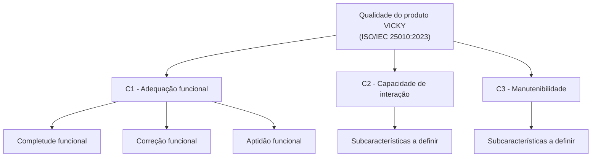

# Modelo de qualidade

## 1. Norma de referência

Modelo de qualidade do produto da **ISO/IEC 25010:2023** (família SQuaRE - ISO/IEC 25000). A terminologia segue a edição de 2023, em que "usabilidade" passou a se chamar **capacidade de interação**.

## 2. Adaptação ao VICKY

_Explicar quais partes do modelo foram mantidas, quais foram descartadas e por quê, com base no contexto do produto e nas [partes interessadas](partes-interessadas.md)._

| Característica | Subcaracterísticas mantidas | Adaptação e justificativa |
|----------------|-----------------------------|---------------------------|
| Adequação funcional | _-_ | _-_ |
| Capacidade de interação | _-_ | _-_ |
| Manutenibilidade | _-_ | _-_ |

## 3. Representação gráfica

_Figura 1 - Modelo de qualidade adaptado ao VICKY. Fonte: elaborada pela equipe com base na ISO/IEC 25010:2023._

## Histórico de versão

| Versão | Data | Descrição | Autor(a) | Revisor(a) |
|--------|------|-----------|----------|------------|
| 0.1 | 16/10/2026 | Página criada a partir da seção "Norma de referência" de Seleção e justificativa | Gabriel Fae | - |
