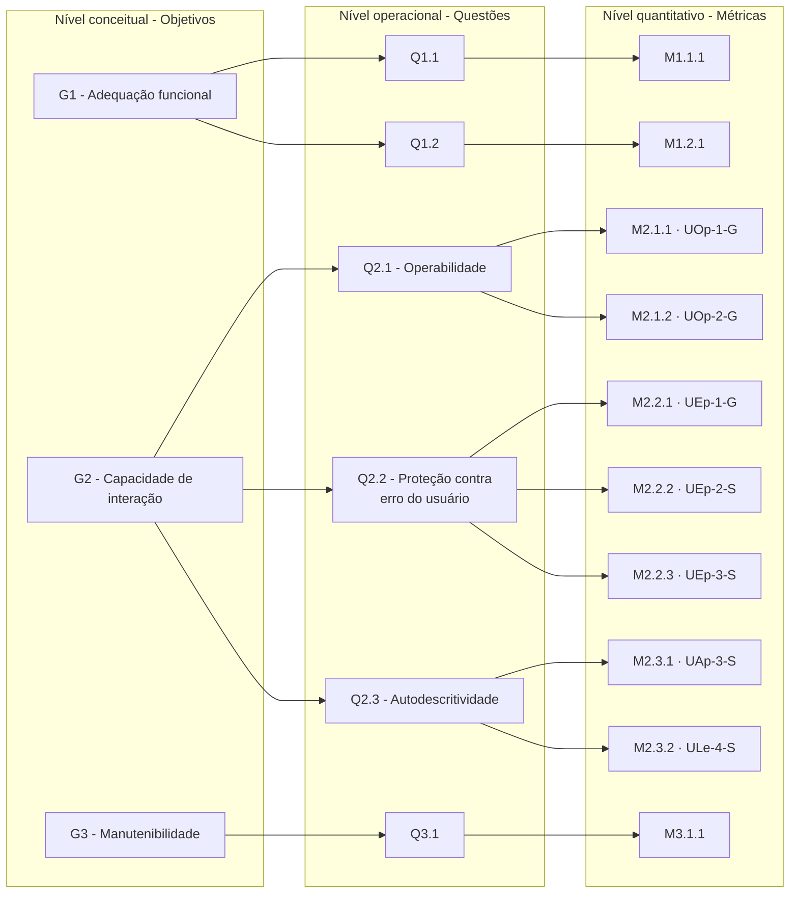

# Diagrama GQM

O diagrama representa a hierarquia completa, com os três níveis identificados formalmente (critério F2-C6). Atualizar sempre que um objetivo, questão ou métrica mudar.

_Figura 1 - Hierarquia GQM da avaliação do VICKY: os três objetivos (nível conceitual), as questões de cada um (nível operacional) e as métricas que respondem a cada questão (nível quantitativo), com o código da medida da ISO/IEC 25023:2016. Fonte: elaborada pela equipe._

## Histórico de versão

| Versão | Data | Descrição | Autor(a) | Revisor(a) |
|--------|------|-----------|----------|------------|
| 0.1 | 05/10/2026 | Criação da estrutura do documento | Gabriel Fae | - |
| 0.2 | 16/10/2026 | Reorganização da documentação por fases do processo de avaliação | Gabriel Fae | - |
| 0.3 | 18/10/2026 | Ramo completo do G2 (capacidade de interação) no diagrama único | Lucas Avelar | Gabriel Fae |
