# Diagrama GQM

A Figura 2 reúne num único diagrama os três objetivos da avaliação, desdobrados em questões e métricas. O diagrama mostra os três níveis do GQM identificados: conceitual, operacional e quantitativo.

```mermaid
flowchart LR
    accTitle: Hierarquia GQM da avaliação do VICKY
    accDescr: Três objetivos (G1 adequação funcional, G2 capacidade de interação e G3 manutenibilidade) ligados às suas questões e cada questão ligada às métricas que a respondem, com o código da medida da ISO/IEC 25023.
    subgraph N1["Nível conceitual - Objetivos"]
        G1["G1 - Adequação funcional"]
        G2["G2 - Capacidade de interação"]
        G3["G3 - Manutenibilidade"]
    end
    subgraph N2["Nível operacional - Questões"]
        Q11["Q1.1 - Completude funcional<br/>(estudos da revisão de referência)"]
        Q12["Q1.2 - Completude funcional<br/>(fluxo prometido)"]
        Q13["Q1.3 - Correção funcional"]
        Q14["Q1.4 - Pertinência funcional<br/>(ranking)"]
        Q15["Q1.5 - Pertinência funcional<br/>(filtros e estabilidade)"]
        Q21["Q2.1 - Reconhecimento<br/>da adequação"]
        Q22["Q2.2 - Facilidade<br/>de aprendizado"]
        Q23["Q2.3 - Operabilidade"]
        Q24["Q2.4 - Proteção contra<br/>erro do usuário"]
        Q25["Q2.5 - Engajamento do usuário<br/>(prioridade secundária)"]
        Q26["Q2.6 - Assistência ao usuário<br/>(contraste e motricidade)"]
        Q27["Q2.7 - Autodescritividade"]
        Q31["Q3.1 - Modularidade"]
        Q32["Q3.2 - Analisabilidade"]
        Q33["Q3.3 - Testabilidade"]
    end
    subgraph N3["Nível quantitativo - Métricas"]
        M111["M1.1.1 · Recall@30 normalizado<br/>(FCp-1-G adaptada)"]
        M112["M1.1.2 · Recall restrito às fontes<br/>(FCp-1-G adaptada)"]
        M121["M1.2.1 · Funções declaradas operantes<br/>(FCp-1-G adaptada)"]
        M131["M1.3.1 · Precisão@30<br/>(FCr-1-G adaptada)"]
        M132["M1.3.2 · Metadados e links corretos<br/>(FCr-1-G adaptada)"]
        M141["M1.4.1 · Spearman score x rubrica<br/>(FAp-1-G adaptada)"]
        M151["M1.5.1 · Conformidade com filtros<br/>(FAp-1-G adaptada)"]
        M152["M1.5.2 · Estabilidade entre execuções<br/>(FAp-1-G adaptada)"]
        M211["M2.1.1 · Completude da descrição<br/>(UAp-1-G)"]
        M221["M2.2.1 · Completude da orientação<br/>(ULe-1-G)"]
        M222["M2.2.2 · Mensagens de erro<br/>(ULe-3-S)"]
        M231["M2.3.1 · Consistência operacional<br/>(UOp-1-G)"]
        M232["M2.3.2 · Clareza das mensagens<br/>(UOp-2-G)"]
        M241["M2.4.1 · Prevenção de erro<br/>(UEp-1-G)"]
        M242["M2.4.2 · Correção de entrada<br/>(UEp-2-S)"]
        M251["M2.5.1 · Estética da interface<br/>(UIn-1-S)"]
        M261["M2.6.1 · Uso só com teclado<br/>(UAc-1-G)"]
        M262["M2.6.2 · Contraste<br/>(medida adicional)"]
        M271["M2.7.1 · Autodescrição da entrada<br/>(UAp-3-S)"]
        M272["M2.7.2 · Interface autoexplicativa<br/>(ULe-4-S)"]
        M311["M3.1.1 · Acoplamento de componentes<br/>(MMo-1-G)"]
        M312["M3.1.2 · Complexidade ciclomática<br/>(MMo-2-S)"]
        M321["M3.2.1 · Conformidade PEP8<br/>(MRe-2-S)"]
        M322["M3.2.2 · Código duplicado<br/>(MRe-1-G)"]
        M323["M3.2.3 · Completude de logs<br/>(MAn-1-G)"]
        M331["M3.3.1 · Completude de testes<br/>(MTe-1-G)"]
    end
    G1 --> Q11 & Q12 & Q13 & Q14 & Q15
    Q11 --> M111 & M112
    Q12 --> M121
    Q13 --> M131 & M132
    Q14 --> M141
    Q15 --> M151 & M152
    G2 --> Q21 & Q22 & Q23 & Q24 & Q25 & Q26 & Q27
    Q21 --> M211
    Q22 --> M221 & M222
    Q23 --> M231 & M232
    Q24 --> M241 & M242
    Q25 --> M251
    Q26 --> M261 & M262
    Q27 --> M271 & M272
    G3 --> Q31 & Q32 & Q33
    Q31 --> M311 & M312
    Q32 --> M321 & M322 & M323
    Q33 --> M331
```

_Figura 2 - Hierarquia GQM da avaliação do VICKY: os três objetivos (nível conceitual), as questões de cada um (nível operacional) e as métricas que respondem a cada questão (nível quantitativo), cada métrica com o nome e o código da medida da ISO/IEC 25023:2016 em que se baseia. Fonte: elaborada pela equipe._

## Histórico de versão

| Versão | Data | Descrição | Autor(a) | Revisor(a) |
|--------|------|-----------|----------|------------|
| 0.1 | 05/10/2026 | Criação da estrutura do documento | Gabriel Fae | - |
| 0.2 | 16/10/2026 | Reorganização da documentação por fases do processo de avaliação | Gabriel Fae | - |
| 0.3 | 18/10/2026 | Ramo completo do G2 (capacidade de interação) no diagrama único | Lucas Avelar | Gabriel Fae |
| 0.4 | 18/10/2026 | Ramo completo do G1 (adequação funcional) no diagrama único | Lucas Avelar | Larissa Gomes Silva |
| 0.5 | 18/10/2026 | Diagrama completo com os três objetivos: ramo do G3 (manutenibilidade) e ramo do G2 realinhado ao modelo de qualidade | Lucas Avelar | Gabriel Fae |
| 0.6 | 18/10/2026 | Nome e código da medida em todas as métricas, figura renumerada, chamada no texto e descrição acessível | Lucas Avelar | Gabriel Fae |
