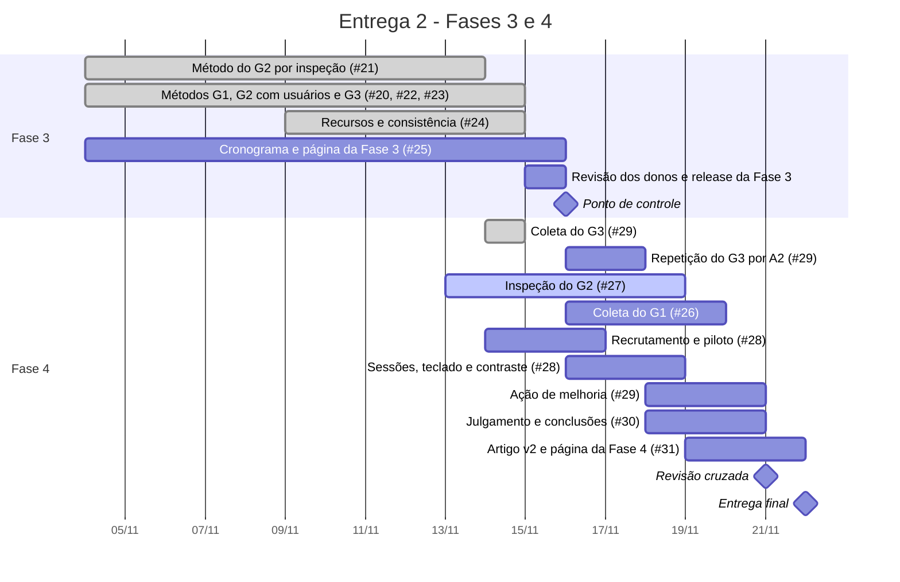

# Cronograma da avaliação

Cronograma da Entrega 2, que cobre a Fase 3 (projetar a avaliação) e a Fase 4 (executar e concluir). Segue as ações da [retrospectiva da Entrega 1](../gestao/retrospectivas/Retrospectiva-E1.docx): ciclos semanais de domingo a domingo, ponto de controle na quarta-feira com entrega parcial, prazo interno antes do prazo oficial e revisão cruzada um dia antes.

A versão 0.2 replaneja as datas a partir da situação de 14/11/2026. Os métodos da Fase 3 fecharam em 14/11, dois dias depois do fim planejado (12/11), e parte deles foi assumida por outro integrante pela [D12](../gestao/decisoes.md) (trabalho não entregue no prazo passa a outro integrante, com comunicação à professora). Os marcos oficiais da disciplina não mudam.

## 1. Marcos

| Data | Marco | Situação em 14/11 |
|------|-------|-------------------|
| 04/11/2026 (qua) | Milestones e issues da Entrega 2 abertas no repositório | Feito |
| 11/11/2026 (qua) | Ponto de controle interno: rascunho de todos os métodos da Fase 3 | Não cumprido: em 13/11, só a #21 estava fechada ([registro de medições](../gestao/registro-de-medicoes.md)) |
| 13/11/2026 (sex) | Adoção da D12: redistribuição do trabalho não entregue | Feito |
| 14/11/2026 (sáb) | Métodos da Fase 3 fechados (G1, G2 por inspeção, G2 com usuários e G3), recursos e consistência; coleta do G3 | Feito |
| 15/11/2026 (dom) | Revisão de cada página pelo dono original; release da Fase 3 até 23h59 | Previsto |
| **16/11/2026 (seg), 14h** | **Ponto de controle da disciplina: Fase 3 completa e correções da Entrega 1** | Previsto |
| 18/11/2026 (qua) | Ponto de controle interno: inspeção do G2, sessões com participantes e triagens do G1 fechadas, dados brutos no repositório | Previsto |
| 19/11/2026 (qui) | Fim da coleta do G1 (julgamento, kappa e cálculo) | Previsto |
| 20/11/2026 (sex) | Julgamento, conclusões e ação de melhoria medida antes e depois | Previsto |
| 21/11/2026 (sáb) | Artigo v2 fechado; revisão cruzada do artigo e da GitPage | Previsto |
| **22/11/2026 (dom)** | **Entrega final: Fase 4, ação de melhoria, artigo v2 e release E2** | Previsto |

## 2. Atividades

### 2.1 Fase 3

| Atividade | Responsável | Issue | Início | Fim | Depende de | Situação em 14/11 |
|-----------|-------------|:-----:|:------:|:---:|------------|-------------------|
| Método de coleta do G1 | Lucas Avelar, pela D12 (era de Larissa Gomes, que revisa) | #20 | 04/11 | 14/11 | - | Escrito; revisão em 15/11 |
| Método do G2 por inspeção | Gabriel Fae | #21 | 04/11 | 13/11 | - | Fechado |
| Método do G2 com usuários, instrumentos e termo de consentimento | Lucas Avelar, pela D12 (era de João Felipe Oliveira, autor do roteiro de M2.7.2 e do questionário qualitativo, que revisa) | #22 | 04/11 | 14/11 | - | Escrito; revisão em 15/11 |
| Método do G3 | Lucas Avelar, pela D12 (era de Guilherme Moura, que revisa) | #23 | 04/11 | 14/11 | - | Escrito; revisão em 15/11 |
| Recursos, ambiente e tabela de consistência | Lucas Avelar, pela D12 (era de Guilherme Maciel, que revisa) | #24 | 09/11 | 14/11 | #20 a #23 | Escrito; revisão em 15/11 |
| Cronograma, página da Fase 3 e correções da Entrega 1 | Lucas Avelar | #25 | 04/11 | 15/11 | #20 a #24 | Cronograma e página da Fase 3 atualizados; correções da E1 conforme a #25 |
| Revisão das páginas pelos donos originais | Larissa Gomes, João Felipe Oliveira, Guilherme Moura e Guilherme Maciel | #20, #22 a #24 | 15/11 | 15/11 | páginas escritas (14/11) | Previsto |
| Release da Fase 3 | Lucas Avelar | #25 | 15/11 | 15/11 | revisão dos donos | Até 23h59 de 15/11 |

### 2.2 Fase 4

| Atividade | Responsável | Issue | Início | Fim | Depende de |
|-----------|-------------|:-----:|:------:|:---:|------------|
| Coleta do G3 no commit `c2ae570` | Lucas Avelar, pela D12 | #29 | 14/11 | 14/11 | #23. **Feita** |
| Repetição do G3 por A2 e inspeção de M3.2.3 | Guilherme Moura | #29 | 16/11 | 17/11 | coleta de 14/11; acesso ao fork |
| Inspeção do G2 | Gabriel Fae | #27 | 13/11 | 18/11 | #21; triagem T1 do G1 (16/11) para a etapa 6. **Iniciada** |
| Coleta do G1, dia 1: casos F01 a F04, triagens T1 a T4, casos F05 a F09, exportação de T1 | Larissa Gomes | #26 | 16/11 | 16/11 | #20; créditos confirmados; listas de incluídos; avaliadores definidos |
| Coleta do G1, dia 2: T1-B e T3-B (de 24 a 72 horas depois), E1 e E2, fichas cegas e piloto de calibração | Larissa Gomes | #26 | 17/11 | 17/11 | dia 1 |
| Coleta do G1, dias 2 a 4: julgamento de A1 e A2, conferências, kappa, discordâncias e cálculo | Larissa Gomes, com A1, A2 e A3 | #26 | 17/11 | 19/11 | fichas cegas |
| Recrutamento, piloto e preparação das sessões | João Felipe Oliveira | #28 | 14/11 | 16/11 | #22; projeto T1 triado e exportado (16/11) |
| Sessões com participantes (P01 a P05), no máximo três por dia | João Felipe Oliveira | #28 | 16/11 | 18/11 | recrutamento; piloto; termo |
| Teste com teclado e contraste (M2.6.1 e M2.6.2) | João Felipe Oliveira, com K1, K2, A1 e A2 | #28 | 16/11 | 18/11 | #22; uma triagem do G1 para F05 |
| Ação de melhoria: refatoração de `run_full_pipeline` em `src/vicky/pipeline.py`, com `logging` no lugar de `print` | Guilherme Moura | #29 | 18/11 | 20/11 | coleta do G3 (linha de base de 14/11) |
| Medida depois da melhoria: método do G3 no commit da melhoria (`COMMIT=<hash> coletar.sh`) | Guilherme Moura | #29 | 20/11 | 20/11 | ação de melhoria |
| Julgamento e conclusões | Guilherme Maciel | #30 | 18/11 | 20/11 | G3 (14/11), G2 (18/11), G1 (19/11) |
| Artigo v2 e página da Fase 4 | Lucas Avelar | #31 | 19/11 | 21/11 | rascunho de #30 (19/11) |
| Revisão cruzada do artigo e da GitPage | Equipe | #31 | 21/11 | 21/11 | artigo v2 |
| Release E2 e envio da entrega | Lucas Avelar | #31 | 22/11 | 22/11 | revisão cruzada |

**Por que estas datas.** A Fase 4 tem seis dias entre o ponto de controle e a entrega final, e as coletas dependem umas das outras pelo projeto triado de T1 ([recursos e ambiente, seção 3](recursos-e-ambiente.md#3-massa-de-dados)). Por isso:

- **O G3 vem primeiro e já foi feito.** Não usa a produção nem créditos, e a coleta de 14/11 é a linha de base da ação de melhoria.
- **O G1 começa em 16/11 pela triagem T1.** Ela libera a etapa 6 da inspeção, a parte B das sessões e F05 a F09 do teste com teclado. O G1 ocupa quatro dias porque T1-B e T3-B só podem começar 24 horas depois de T1 e T3, e o julgamento de A1 e A2 vem depois das fichas cegas.
- **As sessões ficam entre 16 e 18/11.** O piloto e a primeira sessão só acontecem depois que o projeto T1 foi triado e exportado; com no máximo três sessões por dia, as cinco cabem em 17 e 18/11, e 16/11 fica para o piloto e uma sessão, se houver participante.
- **Julgamento e ação de melhoria correm juntos, de 18 a 20/11.** O julgamento começa pelo G3 e pela inspeção do G2, que fecham primeiro; o G1 entra em 19/11. A melhoria toca as métricas M3.1.2 e M3.2.3 e é medida antes e depois pelo mesmo método do G3, só trocando o commit.
- **O artigo v2 começa em 19/11** com o rascunho do julgamento e fecha em 21/11, a tempo da revisão cruzada.

No gráfico, o fim de cada barra é o dia seguinte ao último dia de trabalho, porque o mermaid trata a data final como exclusiva.

## 3. Acompanhamento

A coleta da medição do projeto segue o [plano de medição](../gestao/plano-de-medicao.md): parcial na quarta-feira e completa no domingo. Na Entrega 2 as datas de coleta são 08/11, 11/11, 15/11, 18/11 e 22/11. Cada integrante registra as horas em `dados/gestao/esforco.csv` no dia em que fecha a tarefa. Na coleta de 15/11 entra a verificação da D12: quais partes foram redistribuídas, se as issues foram reatribuídas no GitHub e se a professora foi comunicada.

## 4. Riscos do cronograma

| Risco | Efeito | Resposta |
|-------|--------|----------|
| Créditos de cortesia insuficientes para as oito triagens do G1 | Métricas do G1 sem coleta em algum tema | Confirmar o saldo até 16/11, antes da etapa 3 do G1; com menos de oito, seguir a ordem de prioridade do [método do G1](metodo-g1.md#35-contas-creditos-e-divisao-das-triagens), que preserva as métricas críticas |
| Triagem T1 atrasada ou com falha em 16/11 | Inspeção (etapa 6), sessões (parte B) e teste com teclado (F06 a F09) parados | T1 é a primeira triagem do G1; se falhar, repetir com a mesma configuração (método do G1, seção 7.3). Se T1 não estiver triado na véspera da P01, as sessões usam o projeto triado mais antigo do G1, como prevê o método do G2 com usuários |
| Menos de cinco participantes válidos até 18/11 | M2.5.1 e M2.7.2 não coletadas | Duas reservas convidadas desde o início. Com menos de cinco sessões válidas, o método **não calcula** as duas métricas e a Fase 4 as declara não coletadas, sem proporção sobre quatro |
| Limite de prévias por IP atingido no mesmo dia | Sessão ou triagem bloqueada | Sessões na rede do celular do condutor, no máximo três por dia; a etapa E08 da inspeção em outro dia e outra rede ([recursos e ambiente, seção 2.3](recursos-e-ambiente.md#23-limites-de-uso-do-vicky)) |
| Avaliadores não definidos ou sem a independência exigida | Julgamento de M1.3.1, M1.4.1 e das fichas do G2 sem validade | Definir os papéis até 15/11 ([decisões pendentes](recursos-e-ambiente.md#6-decisoes-pendentes-antes-da-coleta)); pela D12, papel sem dono é assumido por outro integrante |
| Kappa abaixo de 0,61 em algum tema do G1 | Rejulgamento exige 24 horas ou mais depois da primeira rodada | O julgamento começa em 17/11, o que deixa espaço para uma segunda rodada até 19/11; persistindo, o tema sai da média, como manda o método |
| Nova versão do VICKY publicada no meio da coleta | Dados de versões diferentes na mesma métrica | Registrar data, hora e versão dos Termos em cada pasta de dados, como pedem os métodos |
| Trabalho acumulado no último dia, como na Entrega 1 | Retrabalho e revisão tardia | Ponto de controle interno de 18/11 com dados brutos no repositório; artigo fechado em 21/11, um dia antes da entrega |

## Histórico de versão

| Versão | Data | Descrição | Autor(a) | Revisor(a) |
|--------|------|-----------|----------|------------|
| 0.1 | 04/11/2026 | Cronograma da Entrega 2 com marcos, atividades, dependências, acompanhamento e riscos | Lucas Avelar | - |
| 0.2 | 14/11/2026 | Replanejamento a partir de 14/11: fim da Fase 3 com revisão dos donos em 15/11, partes da Fase 3 assumidas pela D12, Fase 4 com o G3 já coletado, G1 de 16 a 19/11, sessões de 16 a 18/11, julgamento e ação de melhoria de 18 a 20/11, artigo v2 de 19 a 21/11, gantt e riscos atualizados | Lucas Avelar | - |
