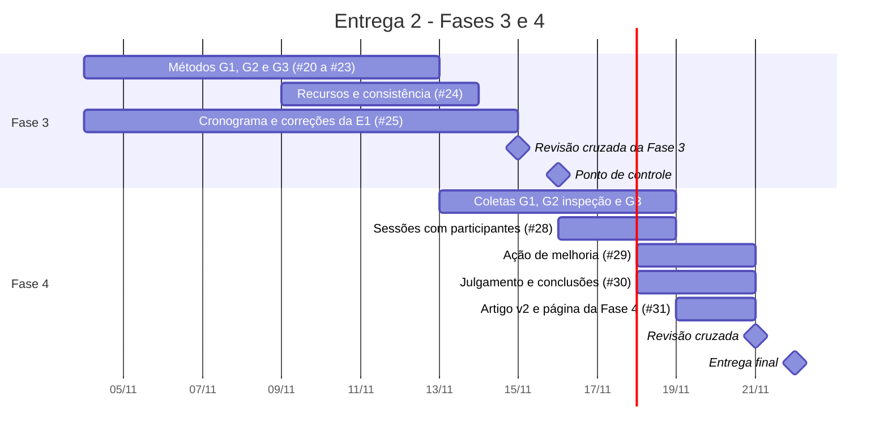

# Cronograma da avaliação

Cronograma da Entrega 2, que cobre a Fase 3 (projetar a avaliação) e a Fase 4 (executar e concluir). Segue as ações da [retrospectiva da Entrega 1](../gestao/retrospectivas/Retrospectiva-E1.docx): ciclos semanais de domingo a domingo, ponto de controle na quarta-feira com entrega parcial, prazo interno dois dias antes do prazo oficial e revisão cruzada um dia antes.

## 1. Marcos

| Data | Marco |
|------|-------|
| 04/11/2026 (qua) | Milestones e issues da Entrega 2 abertas no repositório |
| 11/11/2026 (qua) | Ponto de controle interno: rascunho de todos os métodos da Fase 3 |
| 14/11/2026 (sáb) | Prazo interno da Fase 3 |
| 15/11/2026 (dom) | Revisão cruzada da Fase 3 |
| **16/11/2026 (seg)** | **Ponto de controle da disciplina: Fase 3 completa e correções da Entrega 1** |
| 18/11/2026 (qua) | Ponto de controle interno: coletas fechadas e dados brutos no repositório |
| 20/11/2026 (sex) | Prazo interno da Fase 4 e do artigo v2 |
| 21/11/2026 (sáb) | Revisão cruzada do artigo e da GitPage |
| **22/11/2026 (dom)** | **Entrega final: Fase 4, ação de melhoria, artigo v2 e release E2** |

## 2. Atividades

| Atividade | Responsável | Issue | Início | Fim | Depende de |
|-----------|-------------|:-----:|:------:|:---:|------------|
| Método de coleta do G1 | Larissa Gomes | #20 | 04/11 | 12/11 | - |
| Método do G2 por inspeção | Gabriel Fae | #21 | 04/11 | 12/11 | - |
| Método do G2 com usuários, termo de consentimento e recrutamento | João Felipe Oliveira | #22 | 04/11 | 12/11 | - |
| Método do G3 | Guilherme Moura | #23 | 04/11 | 12/11 | - |
| Recursos, ambiente e tabela de consistência | Guilherme Maciel | #24 | 09/11 | 13/11 | rascunhos de #20 a #23 (11/11) |
| Cronograma, página da Fase 3 e correções da Entrega 1 | Lucas Avelar | #25 | 04/11 | 14/11 | - |
| Coleta e respostas do G1 | Larissa Gomes | #26 | 13/11 | 18/11 | #20, #24 |
| Coleta e respostas do G2 por inspeção | Gabriel Fae | #27 | 13/11 | 18/11 | #21 |
| Sessões com participantes e respostas do G2 | João Felipe Oliveira | #28 | 16/11 | 18/11 | #22 |
| Coleta do G3 | Guilherme Moura | #29 | 13/11 | 17/11 | #23 |
| Ação de melhoria | Guilherme Moura | #29 | 18/11 | 20/11 | resultados de #26 a #29 |
| Julgamento e conclusões | Guilherme Maciel | #30 | 18/11 | 20/11 | #26 a #29 (18/11) |
| Artigo v2 e página da Fase 4 | Lucas Avelar | #31 | 19/11 | 20/11 | rascunho de #30 (19/11) |
| Release E2 e envio da entrega | Lucas Avelar | #31 | 22/11 | 22/11 | revisão cruzada (21/11) |

A Fase 4 tem seis dias entre o ponto de controle e a entrega final. Por isso as coletas começam assim que o método correspondente fica pronto, sem esperar o ponto de controle de 16/11. As sessões com participantes são a exceção: dependem do recrutamento e do termo de consentimento, fechados até 12/11.

## 3. Acompanhamento

A coleta da medição do projeto segue o [plano de medição](../gestao/plano-de-medicao.md): parcial na quarta-feira e completa no domingo. Na Entrega 2 as datas de coleta são 08/11, 11/11, 15/11, 18/11 e 22/11. Cada integrante registra as horas em `dados/gestao/esforco.csv` no dia em que fecha a tarefa.

## 4. Riscos do cronograma

| Risco | Efeito | Resposta |
|-------|--------|----------|
| Créditos na VICKY insuficientes para a triagem completa (F05) nos quatro temas de teste | Coleta do G1 parada | Levantar o número de triagens necessárias até o ponto de controle de 11/11 (#20 e #24) e pedir os créditos antes do início da coleta, em 13/11 |
| Menos de cinco participantes recrutados | M2.5.1 e M2.7.2 com amostra menor que a planejada | Recrutar até 12/11 e registrar o tamanho real da amostra como limitação na Fase 4 |
| Nova versão do VICKY publicada no meio da coleta | Dados de versões diferentes na mesma métrica | Registrar a data e a versão em produção em cada pasta de dados, como pede o README de `dados/avaliacao/` |
| Trabalho acumulado no último dia, como na Entrega 1 | Retrabalho e revisão tardia | Entrega parcial nos pontos de controle de 11/11 e 18/11 e prazo interno dois dias antes de cada entrega |

## Histórico de versão

| Versão | Data | Descrição | Autor(a) | Revisor(a) |
|--------|------|-----------|----------|------------|
| 0.1 | 04/11/2026 | Cronograma da Entrega 2 com marcos, atividades, dependências, acompanhamento e riscos | Lucas Avelar | - |
