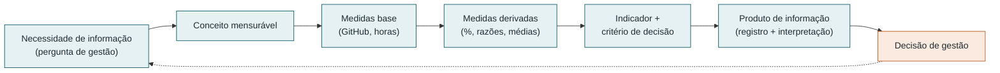
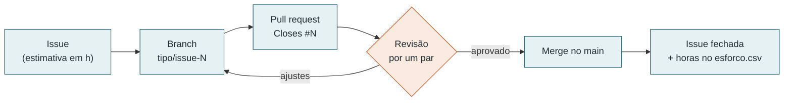

# Gestão do projeto (PSM/CID)

Esta seção trata da **medição do próprio projeto da equipe**, e não do VICKY. Ela acompanha todas as fases da avaliação.

## 1. Base metodológica

A gestão segue o **PSM** (*Practical Software and Systems Measurement*), que é orientado a necessidades de informação: cada medida existe para responder a uma pergunta de gestão e apoiar uma decisão (McGarry et al., 2002). Para um trabalho em equipe organizado em ciclos curtos, a equipe adota o **PSM CID** (*Continuous Iterative Development Measurement Framework*, v2.1, 2021). O CID adapta o PSM a desenvolvimento iterativo e define medidas de fluxo, como *burndown*, comprometido x concluído, *lead time* e fluxo cumulativo.

Os dois modelos do PSM orientam esta seção:

- **Modelo de informação de medição** (derivado da ISO/IEC/IEEE 15939): liga a *necessidade de informação* a um conceito mensurável, que vira medidas base, depois medidas derivadas e por fim um indicador com critério de decisão. Cada métrica do [plano de medição](plano-de-medicao.md) segue essa estrutura.

- **Modelo de processo de medição**: um ciclo de planejar, executar e avaliar a medição, sustentado pelo *compromisso da equipe*. Os resultados alimentam as decisões técnicas e de gestão.

_Figura 1 - Modelo de informação de medição aplicado à gestão da equipe. Fonte: elaborada pela equipe com base em McGarry et al. (2002) e ISO/IEC/IEEE 15939._

## 2. Categorias de informação e métricas

A especificação exige três categorias de informação do PSM. Cada uma recebe três métricas, ligadas à linha correspondente da tabela ICM (*Information Category - Measurable Concept - Measures*) do CID. A base **hora/valor** entra pelo **valor agregado** (*Earned Value*, linha 8 da tabela ICM): todo o trabalho é planejado em horas, e o andamento é medido pelas horas planejadas que viraram entrega.

| Categoria PSM | Pergunta de gestão | Métricas | Referência no CID |
|---------------|--------------------|----------|-------------------|
| **Calendário e Progresso** | Vamos entregar no prazo? | CP1 Comprometido x concluído · CP2 Índice de desempenho de prazo (SPI) | ICM linhas 1 e 8; especificações 8.2 e 8.3 |
| **Recursos e Custos** | O esforço está dentro do planejado e bem distribuído? | RC1 Variação de esforço · RC2 Índice de desempenho de custo (CPI) · RC3 Contribuição individual | ICM linhas 7, 8 e 10 |
| **Desempenho dos Processos** | Nosso fluxo de trabalho é eficiente e previsível? | DP1 *Lead time* de issue · DP2 Vazão e trabalho em andamento · DP3 Concentração do trabalho · DP4 Taxa de retrabalho | ICM linhas 19, 30, 32 e 37; especificações 8.4 e 8.5 |

O detalhamento de cada métrica (medidas base, fórmula, fonte, critério de decisão e ação disparada) está no [plano de medição](plano-de-medicao.md).

## 3. Como a equipe é gerida

### 3.1 Organização do trabalho

| Elemento | Definição |
|----------|-----------|
| Método | Kanban em ciclos semanais (iterações do CID). Cada entrega da disciplina é uma *release* com uma milestone (E1, E2, ...) |
| Unidade de trabalho | Issue do GitHub, com responsável, milestone, rótulo de categoria e **estimativa em horas** |
| Quadro | GitHub Projects com as colunas *Backlog → A fazer → Em andamento → Em revisão → Concluído* |
| Limite de trabalho em andamento (WIP) | No máximo **2 issues "Em andamento" por integrante** |
| Definição de pronto | Conteúdo no `main` via PR revisado, histórico de versão atualizado, links e figuras conferidos e issue fechada com `Closes #N` |
| Registro de esforço | Cada integrante lança suas horas em [`dados/gestao/esforco.csv`](https://github.com/FCTE-Qualidade-de-Software-1/2026-2_T02_FRANCES_ALLEN/blob/main/dados/gestao/esforco.csv) até o fim do ciclo, citando a issue, ou adiciona em "registro de medições". |

### 3.2 Ritos do ciclo semanal

| Momento | Rito | Saída |
|---------|------|-------|
| Domingo (início do ciclo) | Planejamento: escolher as issues do ciclo e estimar as horas | Issues no quadro "A fazer" e linha de base de horas (valor planejado) |
| Quarta-feira | Ponto de controle: coleta parcial de CP1, CP2 e DP2 | Ajustes de prazo ou redistribuição, se algum indicador estiver em alerta |
| Domingo (fim do ciclo) | Revisão e retrospectiva: coleta completa | Linha no [registro de medições](registro-de-medicoes.md), [decisões](decisoes.md) e [ata](atas.md) |

### 3.3 Fluxo no repositório

_Figura 2 - Fluxo de trabalho no repositório adotado a partir do ciclo 2. Fonte: elaborada pela equipe._

Esse fluxo é o que torna as medidas coletáveis. Sem PR não há como medir retrabalho em revisão, e sem `Closes #N` não há como ligar commits a issues nem medir *lead time*.

## 4. Documentos da gestão

| Documento | Conteúdo |
|-----------|----------|
| [Plano de medição](plano-de-medicao.md) | Especificação das 10 métricas, parâmetros e limitações dos dados |
| [Registro de medições](registro-de-medicoes.md) | Valores medidos por ciclo, gráficos e interpretação |
| [Decisões de gestão](decisoes.md) | Decisões tomadas a partir das medições e seu efeito no ciclo seguinte |
| [Atas de reunião](atas.md) | Registro das reuniões, presença e encaminhamentos |

Dados brutos em [`dados/gestao/`](https://github.com/FCTE-Qualidade-de-Software-1/2026-2_T02_FRANCES_ALLEN/tree/main/dados/gestao): `commits.csv` (histórico de commits classificado), `linha-de-base-e1.csv` (issues da E1 com horas estimadas) e `esforco.csv` (horas reais).

## Referências da seção

- McGARRY, J. et al. *Practical Software Measurement: Objective Information for Decision Makers*. Boston: Addison-Wesley, 2002. Caps. 1 e 2.
- JONES, C. L. et al. (ed.). *PSM Continuous Iterative Development Measurement Framework*, v2.1. PSM, NDIA, INCOSE, 2021. Partes 1, 2 e 3.
- ISO/IEC/IEEE 15939:2017. *Systems and software engineering - Measurement process*.

## Histórico de versão

| Versão | Data | Descrição | Autor(a) | Revisor(a) |
|--------|------|-----------|----------|------------|
| 0.1 | 05/10/2026 | Criação da estrutura do documento | Gabriel Fae | - |
| 0.2 | 16/10/2026 | Reorganização da documentação por fases do processo de avaliação | Gabriel Fae | - |
| 0.3 | 25/10/2026 | Base metodológica PSM/CID, métricas por categoria, método de gestão da equipe e fluxo no repositório | Gabriel Fae | - |
