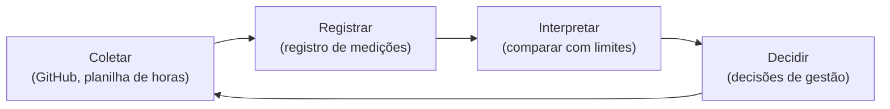

# Gestão do projeto (PSM/CID)

> Utilizar métricas do PSM/CID para acompanhar a execução do projeto. Registrar as medições, sua interpretação e as decisões de gestão decorrentes dos resultados.
>
> _Premissa 3 - Especificação do trabalho final, FGA0315 - 2026.2_

Esta seção trata da **medição do próprio projeto da equipe**, e não do VICKY, e acompanha todas as fases da avaliação. Ela segue o PSM (Practical Software Measurement), em que cada **categoria de informação** se desdobra em **conceitos mensuráveis** e estes em **medidas**. A especificação exige três categorias:

| Categoria de informação | Conceito mensurável | Pergunta de gestão |
|-------------------------|---------------------|--------------------|
| Calendário e Progresso | Cumprimento de marcos; progresso do trabalho | Vamos entregar no prazo? |
| Recursos e Custos | Esforço da equipe; distribuição do trabalho | O esforço está dentro do planejado e bem distribuído? |
| Desempenho dos Processos | Eficiência e qualidade do processo de trabalho | Nosso processo de revisão e execução funciona? |

## Ciclo de medição da gestão

| Documento | Conteúdo |
|-----------|----------|
| [Plano de medição da gestão](plano-de-medicao.md) | Indicadores, fórmulas, fontes, frequência e limites |
| [Registro de medições](registro-de-medicoes.md) | Valores medidos a cada ciclo e sua interpretação |
| [Decisões de gestão](decisoes.md) | Decisões tomadas a partir das medições |
| [Atas de reunião](atas.md) | Registro das reuniões da equipe, decisões e presença |

As evidências ficam no repositório: commits, issues, milestones e o quadro do GitHub Projects.

## Histórico de versão

| Versão | Data | Descrição | Autor(a) | Revisor(a) |
|--------|------|-----------|----------|------------|
| 0.1 | 05/10/2026 | Criação da estrutura do documento | Gabriel Fae | - |
| 0.2 | 16/10/2026 | Reorganização da documentação por fases do processo de avaliação | Gabriel Fae | - |
