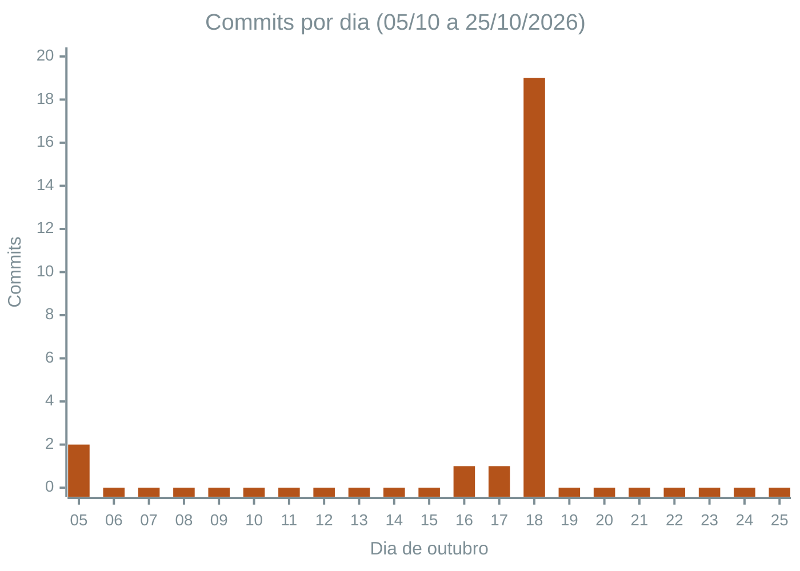
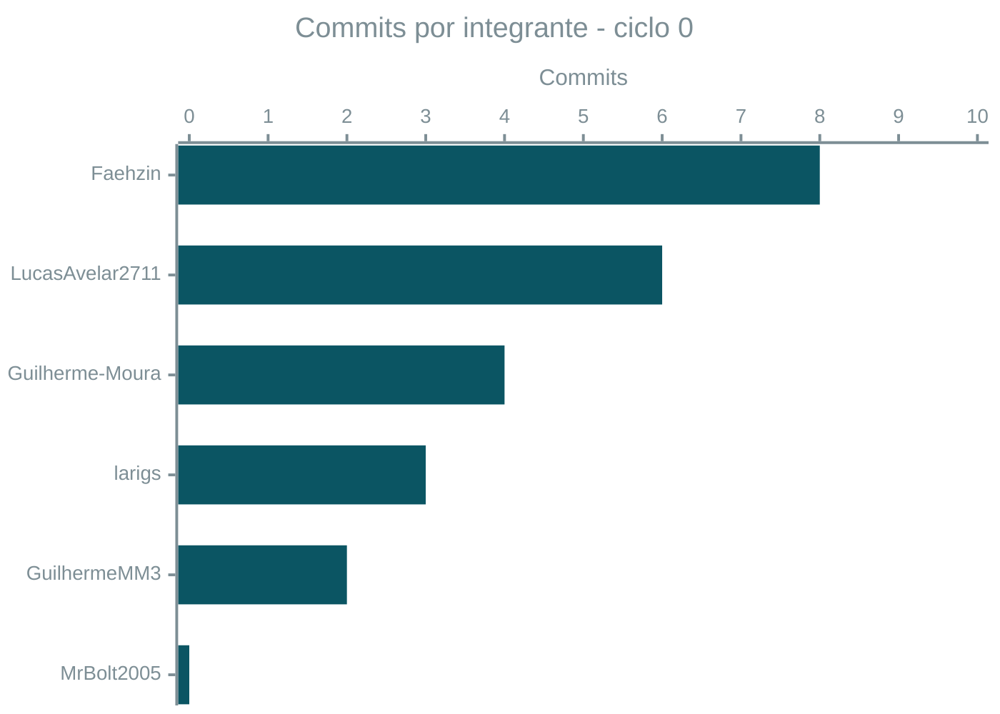
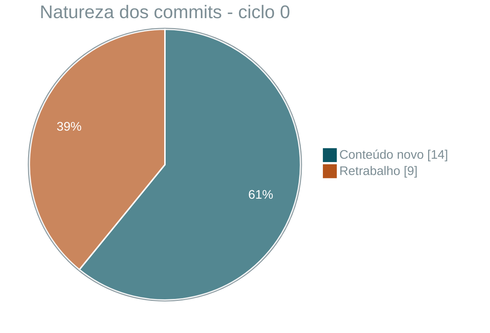
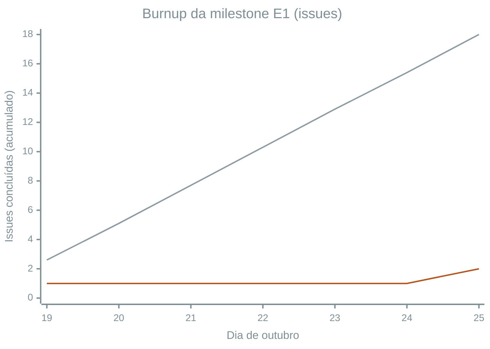
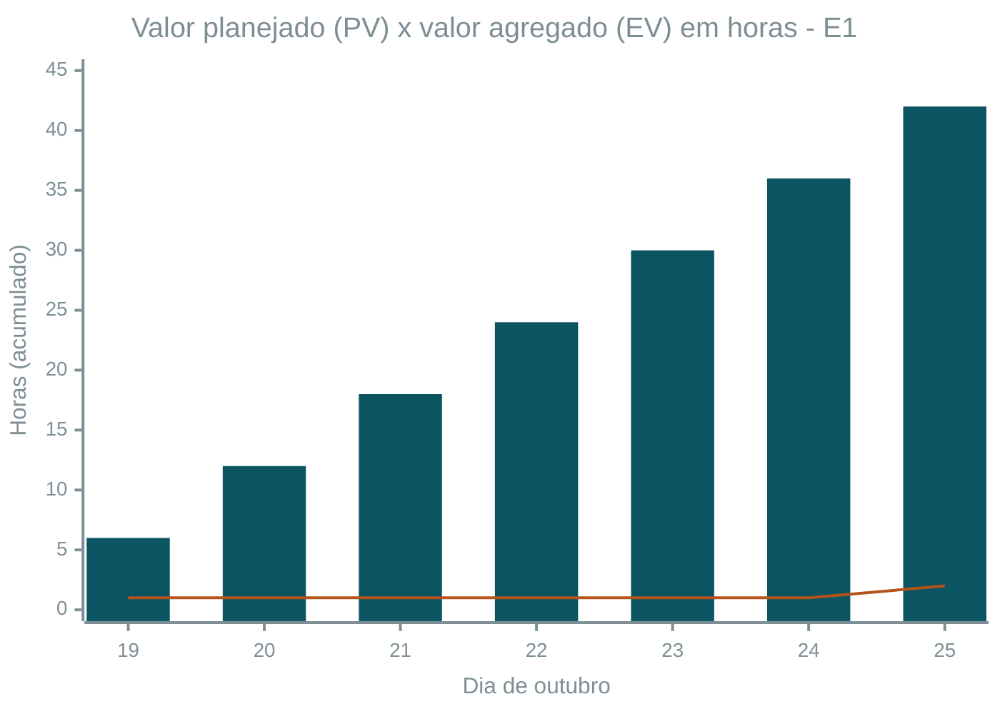

# Registro de medições

Valores medidos a cada ciclo, com interpretação. As fórmulas e faixas de decisão estão no [plano de medição](plano-de-medicao.md), e os dados brutos ficam em [`dados/gestao/`](https://github.com/FCTE-Qualidade-de-Software-1/2026-2_T02_FRANCES_ALLEN/tree/main/dados/gestao). Situação: (OK) dentro da faixa · (A) alerta · (AN) ação necessária · (--) não mensurável no ciclo.

| Ciclo | Período | Marco | Coleta |
|-------|---------|-------|--------|
| 0 (retroativo) | 05/10 a 18/10/2026 | Estruturação e produção das Fases 1 e 2 | 25/10/2026, a partir do `git log` |
| 1 | 19/10 a 25/10/2026 | Milestone E1 (vence em 25/10, 21h) | 25/10/2026 |

## 1. Painel dos ciclos

| Métrica | Ciclo 0 | Ciclo 1 |
|---------|---------|---------|
| CP1 Comprometido x concluído | (--) sem backlog formal | (--) 11,1% concluído (issues criadas com base no artigo.) |
| CP2 SPI (hora/valor) | (--) sem linha de base | (AN) 0,05 |
| RC1 Variação de esforço | (--) horas não registradas | (--) horas não registradas |
| RC2 CPI (hora/valor) | (--) horas não registradas | (--) horas não registradas |
| RC3 Contribuição individual | (AN) 0% a 34,8% (*proxy*: commits) | (A) 7,1% a 28,6% (carga planejada) |
| DP1 *Lead time* | (--) sem issues | (AN) média de 3,1 dias nas fechadas; abertas com 6,2 dias |
| DP2 Razão saída/chegada | (--) sem issues | (AN) 0,11 (2 saídas para 18 chegadas) |
| DP3 Índice de pico | (AN) 82,6% em 18/10 | (--) nenhum commit no repositório |
| DP4 Retrabalho | (AN) 39,1% | (--) nenhum commit no repositório |

## 2. Ciclo 0 (retroativo): 05/10 a 18/10

### 2.1 Medições

| Métrica | Valor | Limite | Situação | Interpretação |
|---------|-------|--------|:--------:|---------------|
| CP1 / CP2 | Não aplicável | - | (--) | Não existiam milestone nem issues. O trabalho não tinha compromisso registrado, e a ausência dessa informação já é um achado (*lack of information*, PSM cap. 2) |
| RC1 / RC2 | Não aplicável | - | (--) | Só um membro declarou horas. Revisão necessária. |
| RC3 (*proxy*: commits) | Faehzin 34,8% · LucasAvelar2711 26,1% · Guilherme-Moura 17,4% · larigs 13,0% · GuilhermeMM3 8,7% · MrBolt2005 0% | 13% a 20% | (AN) | Distribuição desigual. A estruturação inicial do repositório concentrou commits e trabalho, considerando que João Felipe trabalhou no overleaf |
| RC3 (*proxy*: linhas, sem os commits de estruturação) | LucasAvelar2711 44,4% · Faehzin 20,9% · larigs 16,5% · Guilherme-Moura 16,1% · GuilhermeMM3 2,2% · MrBolt2005 0% | 13% a 20% | (AN) | Em volume de conteúdo, os objetivos GQM (G2 e diagrama) concentraram a produção |
| DP3 Índice de pico | 19 de 23 commits em 18/10 = **82,6%**. 4 dias ativos em 14 | ≤ 40% | (AN) | O trabalho se acumulou em um único dia, às vésperas da criação das issues da E1 |
| DP4 Retrabalho | 9 de 23 commits = **39,1%** (em 18/10: 8 de 19 = 42,1%) | ≤ 20% | (AN) | O pico gerou revisão de estrutura em sequência: faixas de nível com buracos, G2 realinhado às sete subcaracterísticas, troca de modificabilidade por testabilidade em C3, correções de redação |
| Revisão de PR | -- | - | (--) | Não houve revisão formal. |

### 2.2 Gráficos

_Figura 1 - Commits por dia no repositório (sem os commits de merge). Indicador DP3. Fonte: [`commits.csv`](https://github.com/FCTE-Qualidade-de-Software-1/2026-2_T02_FRANCES_ALLEN/blob/main/dados/gestao/commits.csv)._

_Figura 2 - Commits por integrante no ciclo 0, como proxy do RC3 até o registro de horas. Fonte: `commits.csv`._

_Figura 3 - Proporção de commits de retrabalho no ciclo 0. Indicador DP4. Fonte: `commits.csv` (coluna `tipo`)._

## 3. Ciclo 1: 19/10 a 25/10 (milestone E1)

### 3.1 Medições

| Métrica | Valor | Limite | Situação | Interpretação |
|---------|-------|--------|:--------:|---------------|
| CP1 Comprometido x concluído | 2 de 18 issues = **11,1%**, com 100% do período decorrido (desvio de 88,9 p.p.). Issues do artigo: 0 de 9 | desvio ≤ 5 p.p. | (AN) | Backlog aberto pois se relaciona à completude do artigo. |
| CP2 SPI | PV = 42 h · EV = 2 h (#11 e #15) · **SPI = 0,05** | ≥ 0,90 | (AN) | Só 5% do valor planejado foi entregue formalmente. O caminho crítico é o artigo, que concentra 24 h das 42 h |
| RC1 / RC2 | Não mensurável | - | (--) | -- |
| RC3 (carga planejada) | MrBolt2005 28,6% (12 h) · Guilherme-Moura 21,4% (9 h) · GuilhermeMM3 16,7% (7 h) · Faehzin 14,3% (6 h) · larigs 11,9% (5 h) · LucasAvelar2711 7,1% (3 h) | 13% a 20% | (A) | --|
| DP1 E DP2 | Sem avaliação | -- | -- | --| 
| DP3 / DP4 | Nenhum commit entre 19/10 e 25/10 | - | (--) | O trabalho do ciclo (artigo) ocorreu fora do repositório! |

### 3.2 Gráficos

_Figura 4 - Burnup da E1: linha cinza = planejado (18 issues distribuídas de forma linear até 25/10), linha terracota = concluído. Indicador CP1. Fonte: [`linha-de-base-e1.csv`](https://github.com/FCTE-Qualidade-de-Software-1/2026-2_T02_FRANCES_ALLEN/blob/main/dados/gestao/linha-de-base-e1.csv)._

_Figura 5 - Análise de valor agregado da E1: barras = PV, linha = EV. SPI = EV / PV. Indicador CP2. Fonte: `linha-de-base-e1.csv`._

## 4. Próxima coleta

| Ciclo | Data | O que coletar |
|-------|------|---------------|
| 2 (parcial) | Quarta-feira, 28/10/2026 | CP1, CP2, DP2 e horas retroativas dos ciclos 0 e 1 |
| 2 (completo) | Domingo, 01/11/2026 | Todas as métricas, incluindo o primeiro RC1, RC2 e DP4 por PR |

## Histórico de versão

| Versão | Data | Descrição | Autor(a) | Revisor(a) |
|--------|------|-----------|----------|------------|
| 0.1 | 05/10/2026 | Criação da estrutura do documento | Gabriel Fae | - |
| 0.2 | 16/10/2026 | Reorganização da documentação por fases do processo de avaliação | Gabriel Fae | - |
| 0.3 | 25/10/2026 | Registro dos ciclos 0 (retroativo) e 1, painel de indicadores, gráficos e síntese | Gabriel Fae | - |
