# Registro de medições

Valores medidos a cada ciclo, com interpretação. As fórmulas e faixas de decisão estão no [plano de medição](plano-de-medicao.md), e os dados brutos ficam em [`dados/gestao/`](https://github.com/FCTE-Qualidade-de-Software-1/2026-2_T02_FRANCES_ALLEN/tree/main/dados/gestao). Situação: (OK) dentro da faixa · (A) alerta · (AN) ação necessária · (--) não mensurável no ciclo.

| Ciclo | Período | Marco | Coleta |
|-------|---------|-------|--------|
| 0 (retroativo) | 05/10 a 18/10/2026 | Estruturação e produção das Fases 1 e 2 | 25/10/2026, a partir do `git log` |
| 1 | 19/10 a 25/10/2026 | Milestone E1 (vence em 25/10, 21h) | 25/10/2026, às 20h30. Três commits do ciclo entraram depois dessa hora e foram incorporados retroativamente na coleta de 28/10 |
| 2 (em curso) | 26/10 a 01/11/2026 | Fechamento da E1 (*release* `v0.1`) e abertura da E2 | Parcial em 28/10/2026 (quarta-feira). A coleta completa de 01/11 está pendente |

## 1. Painel dos ciclos

| Métrica | Ciclo 0 | Ciclo 1 | Ciclo 2 (parcial, 26 a 28/10) |
|---------|---------|---------|-------------------------------|
| CP1 Comprometido x concluído | (--) sem backlog formal | (--) 11,1% concluído (issues criadas com base no artigo.) | (OK) 100% (18 de 18), desvio de 0 p.p., mas concluído **depois** do vencimento |
| CP2 SPI (hora/valor) | (--) sem linha de base | (AN) 0,05 | (OK) 1,00 na data de corte · 0,05 no vencimento · atraso de 1 a 3 dias |
| RC1 Variação de esforço | (--) horas não registradas | (--) horas não registradas | (AN) 0 de 6 integrantes registraram horas até o prazo da D05 |
| RC2 CPI (hora/valor) | (--) horas não registradas | (--) horas não registradas | (--) sem `AC`, por falta das horas reais. Custo planejado da E1: **R$2.100** (42 h × R$50) |
| RC3 Contribuição individual | (AN) 0% a 34,8% (*proxy*: commits) | (A) 7,1% a 28,6% (carga planejada) | (--) coleta de domingo. A atribuição da E1 ficou desatualizada pelo remanejamento (D08) |
| DP1 *Lead time* | (--) sem issues | (AN) média de 3,1 dias nas fechadas; abertas com 6,2 dias | (--) coleta de domingo. As datas de conclusão foram declaradas em lote, o que torna o *lead time* um limite superior |
| DP2 Razão saída/chegada | (--) sem issues | (AN) 0,11 (2 saídas para 18 chegadas) | (A) 16 saídas e 0 chegadas: razão indefinida. WIP de 0 na data de corte |
| DP3 Índice de pico | (AN) 82,6% em 18/10 | (AN) 100% em 25/10 (3 commits, medido retroativamente) | (--) coleta de domingo. Parcial: 66,7% em 28/10 |
| DP4 Retrabalho | (AN) 39,1% | (AN) 66,7% (2 de 3 commits, medido retroativamente) | (--) por PR: nenhum PR no período. Por commit: 66,7% (2 de 3) |

## 2. Ciclo 0 (retroativo): 05/10 a 18/10

### 2.1 Medições

| Métrica | Valor | Limite | Situação | Interpretação |
|---------|-------|--------|:--------:|---------------|
| CP1 / CP2 | Não aplicável | - | (--) | Não existiam milestone nem issues. O trabalho não tinha compromisso registrado, e a ausência dessa informação já é um achado (*lack of information*, PSM cap. 2) |
| RC1 / RC2 | Não aplicável | - | (--) | Só um membro declarou horas. Revisão necessária. |
| RC3 (*proxy*: commits) | Faehzin 34,8% · LucasAvelar2711 26,1% · Guilherme-Moura 17,4% · larigs 13,0% · GuilhermeMM3 8,7% · MrBolt2005 0% | 13% a 20% | (AN) | Distribuição desigual. A estruturação inicial do repositório concentrou commits e trabalho, considerando que João Felipe trabalhou no overleaf |
| RC3 (*proxy*: linhas, sem os commits de estruturação) | LucasAvelar2711 44,4% · Faehzin 20,9% · larigs 16,5% · Guilherme-Moura 16,1% · GuilhermeMM3 2,2% · MrBolt2005 0% | 13% a 20% | (AN) | Em volume de conteúdo, os objetivos GQM (G2 e diagrama) concentraram a produção |
| DP3 Índice de pico | 19 de 23 commits em 18/10 = **82,6%**. 4 dias ativos em 14 | ≤ 40% | (AN) | O trabalho se acumulou em um único dia, às vésperas da criação das issues da E1 |
| DP4 Retrabalho | 9 de 23 commits = **39,1%** (em 18/10: 8 de 19 = 42,1%) | ≤ 20% | (AN) | O pico gerou revisão de estrutura em sequência: faixas de nível com buracos, G2 realinhado às sete subcaracterísticas, troca de modificabilidade por testabilidade em C3, correções de redação |
| Revisão de PR | -- | - | (--) | Não houve revisão formal. |

### 2.2 Gráficos

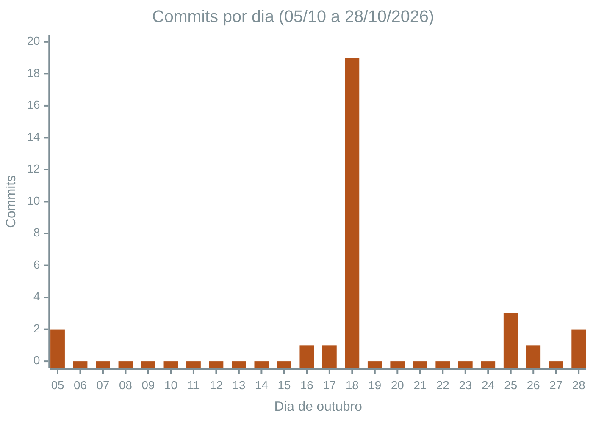

_Figura 1 - Commits por dia no repositório, sem os commits de merge, de 05/10 a 28/10 (29 commits). Os 23 commits até 18/10 são o ciclo 0, os 3 de 25/10 são o ciclo 1 e os 3 de 26 a 28/10 são o parcial do ciclo 2. A barra de 25/10 foi acrescentada na coleta de 28/10: na coleta do próprio ciclo 1 ela aparecia como zero, porque os commits entraram depois do horário da coleta. Indicador DP3. Fonte: [`commits.csv`](https://github.com/FCTE-Qualidade-de-Software-1/2026-2_T02_FRANCES_ALLEN/blob/main/dados/gestao/commits.csv)._

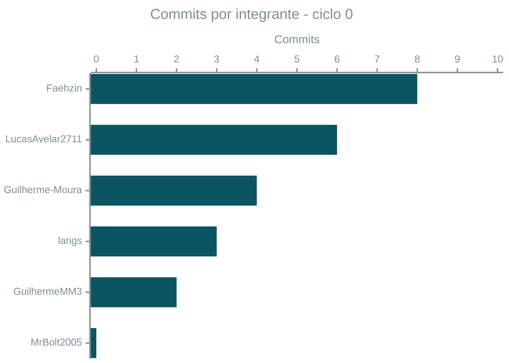

_Figura 2 - Commits por integrante no ciclo 0, como proxy do RC3 até o registro de horas. Fonte: `commits.csv`._

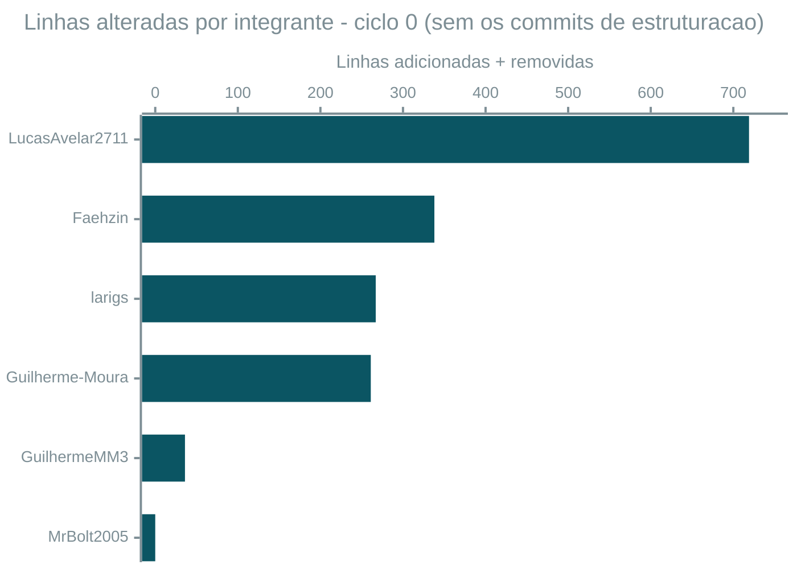

_Figura 3 - Volume de conteúdo por integrante no ciclo 0, em linhas adicionadas mais removidas, excluídos os três commits de estruturação do repositório (1.658 linhas das 3.279 do ciclo). É o segundo *proxy* do RC3 e corresponde aos percentuais da tabela 2.1: LucasAvelar2711 44,4%, Faehzin 20,9%, larigs 16,5%, Guilherme-Moura 16,1% e GuilhermeMM3 2,2%, de um total de 1.621 linhas. **Não há gráfico de horas nem de custo neste ciclo:** não existia linha de base de horas e nenhum integrante registrou esforço, então RC1 e RC2 não são calculáveis para o período. Fonte: [`commits.csv`](https://github.com/FCTE-Qualidade-de-Software-1/2026-2_T02_FRANCES_ALLEN/blob/main/dados/gestao/commits.csv) (colunas `linhas_adicionadas` e `linhas_removidas`)._
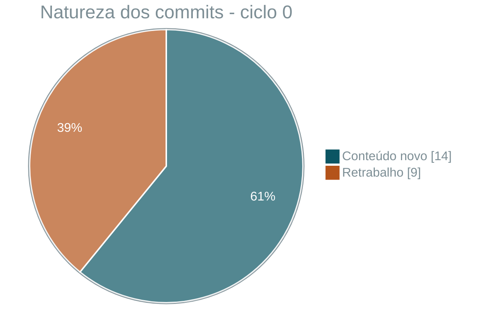

_Figura 4 - Proporção de commits de retrabalho no ciclo 0. Indicador DP4. Fonte: `commits.csv` (coluna `tipo`)._

## 3. Ciclo 1: 19/10 a 25/10 (milestone E1)

### 3.1 Medições

| Métrica | Valor | Limite | Situação | Interpretação |
|---------|-------|--------|:--------:|---------------|
| CP1 Comprometido x concluído | 2 de 18 issues = **11,1%**, com 100% do período decorrido (desvio de 88,9 p.p.). Issues do artigo: 0 de 9 | desvio ≤ 5 p.p. | (AN) | Backlog aberto pois se relaciona à completude do artigo. |
| CP2 SPI | PV = 42 h · EV = 2 h (#11 e #15) · **SPI = 0,05** | ≥ 0,90 | (AN) | Só 5% do valor planejado foi entregue formalmente. O caminho crítico é o artigo, que concentra 24 h das 42 h |
| RC1 / RC2 | Não mensurável | - | (--) | -- |
| RC3 (carga planejada) | MrBolt2005 28,6% (12 h) · Guilherme-Moura 21,4% (9 h) · GuilhermeMM3 16,7% (7 h) · Faehzin 14,3% (6 h) · larigs 11,9% (5 h) · LucasAvelar2711 7,1% (3 h) | 13% a 20% | (A) | --|
| DP1 *Lead time* | Fechadas: média de **3,1 dias** (#15 com 0,01 dia e #11 com 6,2 dias) · abertas: idade média de **6,2 dias** | ≤ 3 dias | (AN) | As duas issues fechadas são as de menor esforço (1 h cada). A idade das 16 abertas já estava acima do limite na data de corte |
| DP2 Razão saída/chegada | 2 saídas para 18 chegadas = **0,11** · WIP de 16 issues (**2,7** por integrante) | ≥ 0,90 · WIP ≤ 2 | (AN) | Todo o backlog da E1 entrou de uma vez em 19/10 e quase nada saiu. O WIP nasceu acima do limite depois fixado na D04 |
| DP3 Índice de pico (retroativo) | 3 de 3 commits em 25/10 = **100%**. 1 dia ativo em 7 | ≤ 40% | (AN) | **Correção retroativa.** Na coleta de 25/10, às 20h30, o ciclo não tinha commits no repositório. Os três commits do ciclo saíram todos em 25/10, dois deles depois da coleta: [`3ce20cc`](https://github.com/FCTE-Qualidade-de-Software-1/2026-2_T02_FRANCES_ALLEN/commit/3ce20cc) às 20h36, [`31cff66`](https://github.com/FCTE-Qualidade-de-Software-1/2026-2_T02_FRANCES_ALLEN/commit/31cff66) às 21h55 e [`3304199`](https://github.com/FCTE-Qualidade-de-Software-1/2026-2_T02_FRANCES_ALLEN/commit/3304199) às 22h26. O padrão de rajada do ciclo 0 se repetiu, agora na véspera da entrega |
| DP4 Retrabalho (retroativo) | 2 de 3 commits = **66,7%** | ≤ 20% | (AN) | `31cff66` reescreve a H1.5 em Jaccard 0,70 para coincidir com o nível Bom de M1.5.2 e `3304199` enxuga o texto da Fase 2 e realinha F05: as duas correções vêm da revisão estrutural da D02 |
| Rastreabilidade | 0 de 3 commits com `Closes #N` · nenhum PR no ciclo | 100% | (AN) | O trabalho do artigo ocorreu fora do repositório (Overleaf) e as correções da Fase 2 entraram direto no `main` |

### 3.2 Gráficos

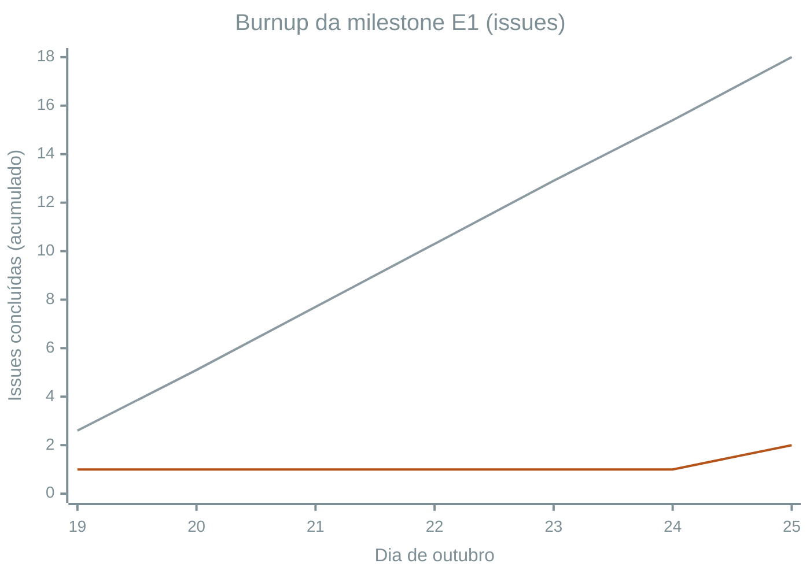

_Figura 5 - Burnup da E1: linha cinza = planejado (18 issues distribuídas de forma linear até 25/10), linha terracota = concluído. Indicador CP1. Fonte: [`linha-de-base-e1.csv`](https://github.com/FCTE-Qualidade-de-Software-1/2026-2_T02_FRANCES_ALLEN/blob/main/dados/gestao/linha-de-base-e1.csv)._

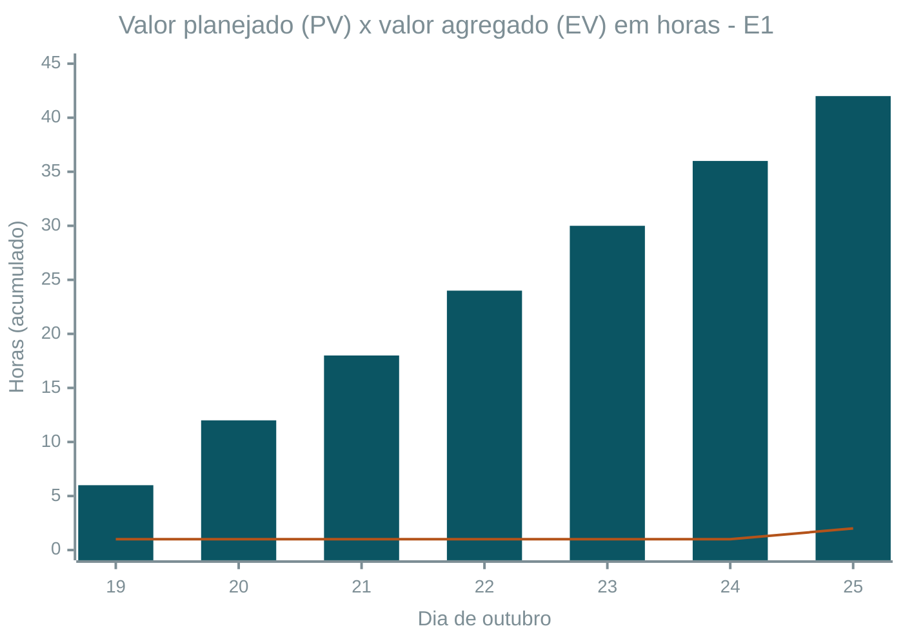

_Figura 6 - Análise de valor agregado da E1: barras = PV, linha = EV. SPI = EV / PV. Indicador CP2. Fonte: `linha-de-base-e1.csv`._

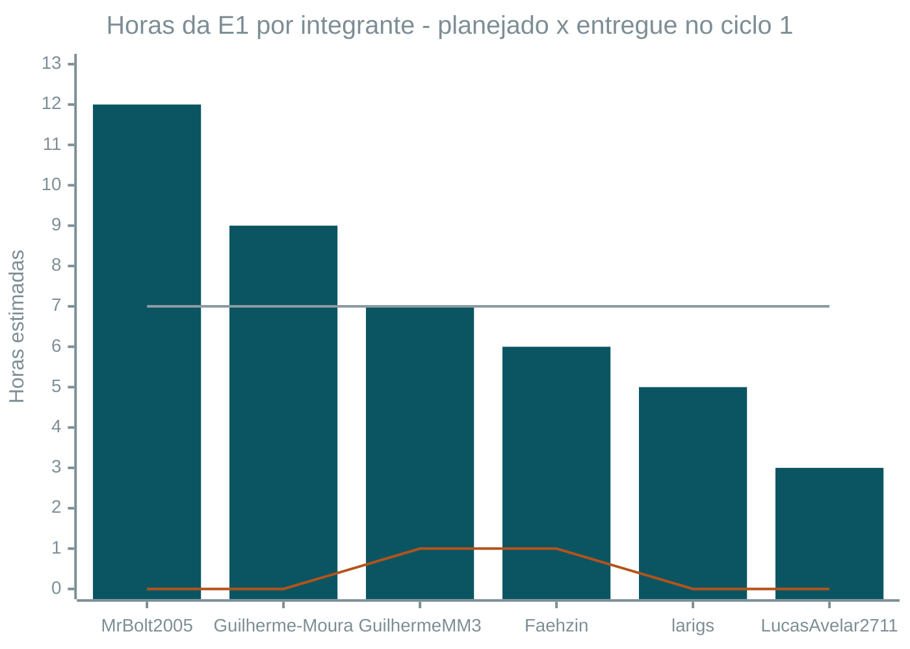

_Figura 7 - Carga da E1 por integrante: barras = horas planejadas (42 h no total), linha terracota = horas entregues até 25/10 (2 h, das issues #11 e #15) e linha cinza = distribuição ideal de 7 h por pessoa, ou 16,7%. É o RC3 pela carga planejada somado ao EV do CP2 por integrante. Duas ressalvas: as horas são **estimadas**, porque nenhuma hora real foi registrada, e a atribuição é a de 19/10, anterior ao remanejamento de 28/10 ([D08](decisoes.md#d08-remanejar-as-divisoes-de-trabalho-da-equipe)). Fonte: `linha-de-base-e1.csv`._

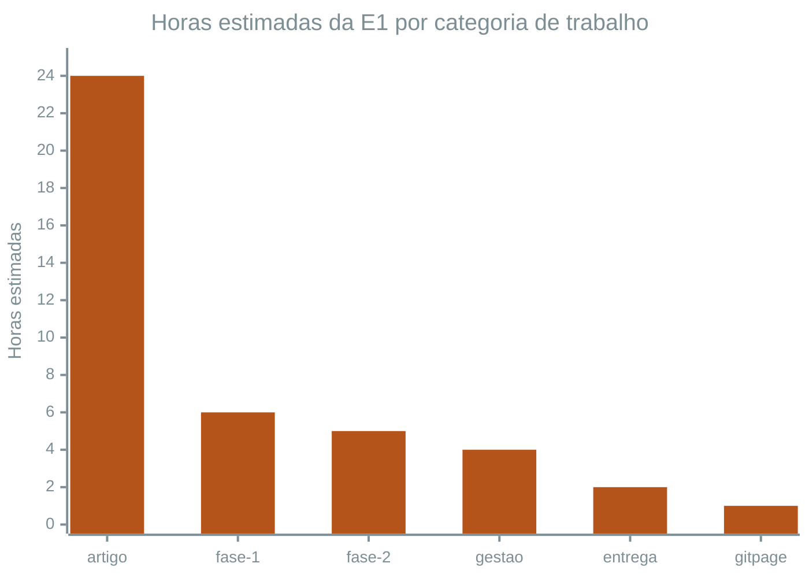

_Figura 8 - Distribuição das 42 h da E1 por categoria. O artigo concentra 24 h, 57% do valor planejado da entrega, e é o caminho crítico citado na [D03](decisoes.md#d03-recalcular-esforco-pro-artigo): no fim do ciclo 1 nenhuma das suas 9 issues estava fechada, o que por si só explica o SPI de 0,05. Fonte: `linha-de-base-e1.csv` (coluna `categoria`)._

## 4. Ciclo 2 (parcial): 26/10 a 28/10

Coleta do **ponto de controle de quarta-feira** definido na [D04](decisoes.md#d04-readaptar-o-processo-de-desenvolvimento-e-pesquisa). Escopo previsto para esta coleta: **CP1, CP2, DP2 e as horas retroativas dos ciclos 0 e 1**. As demais métricas ficam para a coleta completa de domingo. Data de corte: **28/10/2026, 21h**.

### 4.1 Contexto da coleta

| Item | Registro |
|------|----------|
| Fechamento da E1 | As **18 issues da milestone E1 foram declaradas concluídas** no ponto de controle. A entrega saiu na *release* [`v0.1`](https://github.com/FCTE-Qualidade-de-Software-1/2026-2_T02_FRANCES_ALLEN/releases/tag/v0.1) ("Release E1 - Ponto de Controle 1"), publicada em **26/10 às 20h25**, sobre o commit [`030f62d`](https://github.com/FCTE-Qualidade-de-Software-1/2026-2_T02_FRANCES_ALLEN/commit/030f62d). A retrospectiva da E1 entrou no repositório em 28/10 ([`5741d9c`](https://github.com/FCTE-Qualidade-de-Software-1/2026-2_T02_FRANCES_ALLEN/commit/5741d9c) e [`f25cb3d`](https://github.com/FCTE-Qualidade-de-Software-1/2026-2_T02_FRANCES_ALLEN/commit/f25cb3d)) |
| Remanejamento das divisões | A equipe **remanejou as divisões de trabalho** no ponto de controle. A coluna `responsavel` da [`linha-de-base-e1.csv`](https://github.com/FCTE-Qualidade-de-Software-1/2026-2_T02_FRANCES_ALLEN/blob/main/dados/gestao/linha-de-base-e1.csv) passa a valer apenas como registro histórico do planejamento da E1: ela não descreve quem executou o trabalho no fechamento e não vale para a E2 (ver [D08](decisoes.md#d08-remanejar-as-divisoes-de-trabalho-da-equipe)) |
| Onde a decisão foi tomada | O ponto de controle **não ocorreu em sala**, por falta de tempo de aula, e correu **fora de sala, de forma assíncrona**, com manifestação de parte da equipe. É o mesmo fator que explica o resultado das horas retroativas abaixo (ver [D09](decisoes.md#d09-canal-assincrono-com-prazo-de-resposta)) |
| Qualidade do dado (importante) | O fechamento das issues foi **declarado em lote** no ponto de controle e **não foi registrado no GitHub**: em consulta à API em 04/11, a milestone E1 ainda constava `open`, com 16 das 18 issues no estado `OPEN` e sem `closedAt`. CP1 e CP2 desta coleta vêm da **declaração do ponto de controle e da *release* `v0.1`**, não do estado das issues na API. É exatamente a falha de rastreabilidade que a [D06](decisoes.md#d06-rastreabilidade-do-trabalho-no-repositorio) deveria ter corrigido, e ela rebaixa a confiança de CP1, CP2, DP1 e DP2 de "medido" para "declarado" |

**Dados brutos desta coleta.** A [`linha-de-base-e1.csv`](https://github.com/FCTE-Qualidade-de-Software-1/2026-2_T02_FRANCES_ALLEN/blob/main/dados/gestao/linha-de-base-e1.csv) ganhou duas colunas, que separam o que foi medido do que foi declarado: `fechada_em` continua sendo a data de fechamento **registrada no GitHub** (preenchida só para as issues #11 e #15) e `concluida_em_declarado` traz a data de conclusão **declarada no ponto de controle** (28/10 para as 16 restantes), com `status_28_10` indicando qual das duas vale para cada issue. A [`commits.csv`](https://github.com/FCTE-Qualidade-de-Software-1/2026-2_T02_FRANCES_ALLEN/blob/main/dados/gestao/commits.csv) recebeu as 6 linhas dos ciclos 1 e 2 que faltavam, com a mesma classificação manual de `tipo` descrita no plano de medição. Como `concluida_em_declarado` é a data do ponto de controle e não a da conclusão real de cada item, o *lead time* (DP1) calculado sobre ela é um **limite superior**.

### 4.2 Medições

| Métrica | Valor | Limite | Situação | Interpretação |
|---------|-------|--------|:--------:|---------------|
| CP1 Comprometido x concluído | `I_conc` = 18 de `I_comp` = 18 = **100% concluído**, com 100% do período decorrido: **desvio de 0 p.p.** (era 88,9 p.p. em 25/10) | desvio ≤ 5 p.p. | (OK) | O escopo da E1 foi entregue **integralmente, mas fora do prazo**. As 9 issues do artigo, que no ciclo 1 estavam todas abertas, foram concluídas em três dias. O indicador entra na faixa OK porque, passado o fim da milestone, `%Planejado` satura em 100% e o desvio se anula: o atraso não aparece mais no CP1 e tem de ser lido no CP2 |
| CP2 SPI na data de corte | `PV` = 42 h (saturado no total da E1) · `EV` = 42 h · **SPI = 1,00** | ≥ 0,90 | (OK) | Todo o valor planejado da E1 virou entrega |
| CP2 SPI no vencimento | No vencimento da milestone (25/10, 21h): `PV` = 42 h · `EV` = 2 h · **SPI = 0,05** | ≥ 0,90 | (AN) | É este o número que descreve o prazo da E1. O SPI converge para 1,00 em qualquer projeto que termine, por mais atrasado que esteja, então o atraso tem de ser registrado em dias, na linha abaixo |
| CP2 Variação de prazo (em dias) | *Release* `v0.1` em 26/10, 20h25 = **~1 dia** após o vencimento · fechamento formal das issues até 28/10 = **3 dias** após o vencimento. Em um ciclo de 7 dias, 14% a 43% de atraso | - | (A) | Efeito direto da [D03](decisoes.md#d03-recalcular-esforco-pro-artigo): com o cronograma do artigo recalculado, as 24 h do caminho crítico saíram, mas estouraram o prazo da E1 |
| DP2 Vazão | **16 saídas** em 3 dias (as outras 2 das 18 já haviam saído no ciclo 1). Extrapolado, 37 issues/semana | - | (A) | Não é vazão sustentável: é a drenagem, de uma só vez, do backlog acumulado de 18 issues. Serve como teto, não como capacidade da equipe |
| DP2 Razão saída/chegada | **0 chegadas** e 16 saídas: razão **indefinida** (divisão por zero) | ≥ 0,90 | (A) | A razão não é calculável porque nenhuma issue nova foi aberta no ciclo. Olhando só o fluxo de saída, o indicador inverteu em relação ao ciclo 1 (0,11): o problema deixou de ser trabalho que não sai e passou a ser trabalho novo que não entra |
| DP2 Trabalho em andamento (WIP) | **0 issues abertas** na data de corte, contra 16 em 25/10. 0 por integrante | ≤ 2 por integrante | (A) | O limite da D04 passou a ser respeitado, mas pelo motivo errado: o WIP é zero porque o backlog da E1 esvaziou e **o da E2 não existe**. Com WIP zero e nenhuma chegada, o ciclo seguinte começa sem trabalho comprometido e CP1, CP2, DP1 e DP2 voltam a ser não mensuráveis (ver [D10](decisoes.md#d10-planejar-o-ciclo-no-github-antes-de-ele-comecar)) |
| Horas retroativas dos ciclos 0 e 1 | [`esforco.csv`](https://github.com/FCTE-Qualidade-de-Software-1/2026-2_T02_FRANCES_ALLEN/blob/main/dados/gestao/esforco.csv) continua **só com o cabeçalho**: **0 de 6 integrantes** registraram horas até o prazo de 28/10 | 6 de 6 | (AN) | A [D05](decisoes.md#d05-registro-obrigatorio-de-horas) **não foi executada**. Sem `H_real` não há `AC`, logo RC1, RC2 e o RC3 por horas reais seguem não mensuráveis pelo terceiro ciclo seguido, e a base hora/valor do plano continua sustentada só por estimativa. A causa registrada é a mesma do contexto: a cobrança correu fora de sala e parte da equipe não respondeu |
| Rastreabilidade (verificação da D06) | 3 commits no período, **0 com `Closes #N`** · **0 PRs** abertos ou revisados (o único PR do repositório é o #1, de 18/10, sem revisão) · `030f62d` ainda com o autor genérico `user` | 100% dos PRs ligados a issue e revisados | (AN) | A **D06 não foi executada**: o fluxo branch → PR → revisão não entrou em uso, os commits foram direto no `main` e a identidade do git não foi corrigida. Por isso o DP4 por PR, previsto para a coleta de domingo, continua sem base de cálculo |
| DP3 / DP4 (parcial, informativo) | 3 commits em 26 a 28/10: [`030f62d`](https://github.com/FCTE-Qualidade-de-Software-1/2026-2_T02_FRANCES_ALLEN/commit/030f62d) (26/10, Guilherme-Moura, retrabalho: README reescrito, 21 linhas por 20), `5741d9c` (28/10, larigs, novo: retrospectiva) e `f25cb3d` (28/10, larigs, retrabalho: troca do arquivo errado). Pico de **66,7%** em 28/10, 2 dias ativos em 3, retrabalho de **66,7%** | pico ≤ 40% · retrabalho ≤ 20% | (--) | Fecha na coleta de domingo. Os dois indicadores já apontam fora da faixa, e os três commits do período são de documentação e correção: o conteúdo do artigo continua fora do repositório |

### 4.3 Gráficos

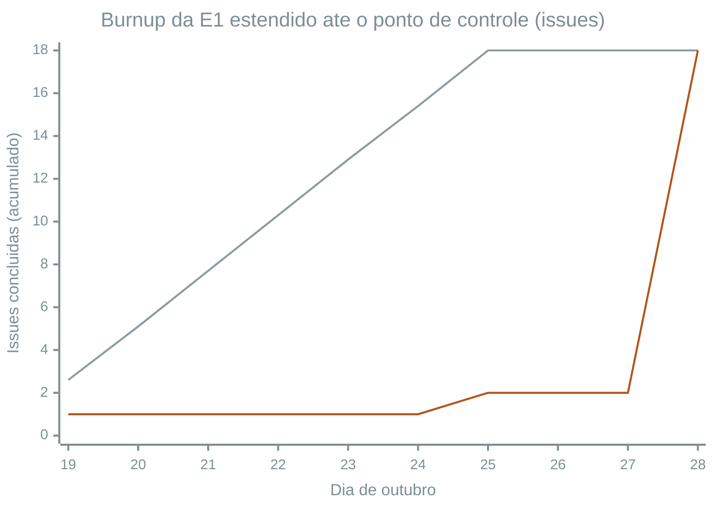

_Figura 9 - Burnup da E1 estendido até 28/10: linha cinza = planejado, linha terracota = concluído. As 16 issues restantes foram declaradas concluídas em bloco no ponto de controle, três dias após o vencimento da milestone. Indicador CP1. Fonte: [`linha-de-base-e1.csv`](https://github.com/FCTE-Qualidade-de-Software-1/2026-2_T02_FRANCES_ALLEN/blob/main/dados/gestao/linha-de-base-e1.csv) e declaração do ponto de controle de 28/10._

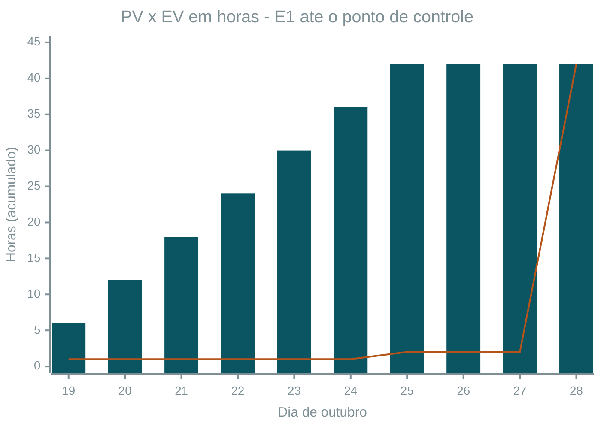

_Figura 10 - Valor planejado (barras) e valor agregado (linha) da E1 até 28/10. O encontro das duas curvas no fim do período é o que faz o SPI ir de 0,05 a 1,00 sem que o atraso desapareça: ele passa a ser lido na variação de prazo em dias. Indicador CP2. Fonte: `linha-de-base-e1.csv`._

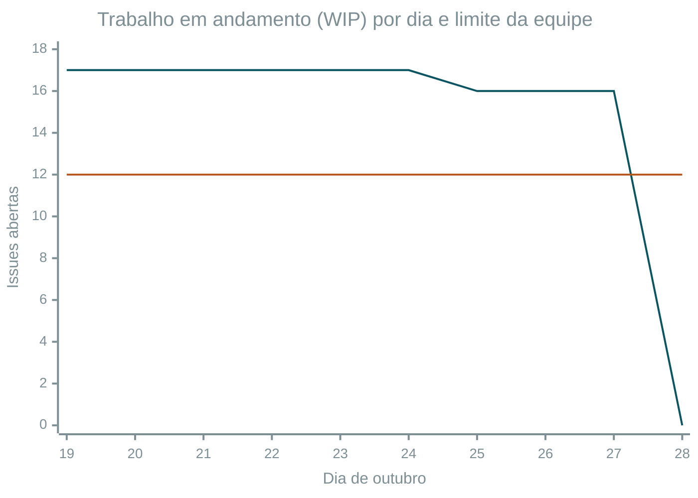

_Figura 11 - WIP diário (linha azul) contra o limite da equipe de 12 issues, ou 2 por integrante (linha terracota). O WIP ficou acima do limite por nove dias e caiu a zero de uma vez no ponto de controle. Indicador DP2. Fonte: issues da milestone E1 e declaração do ponto de controle._

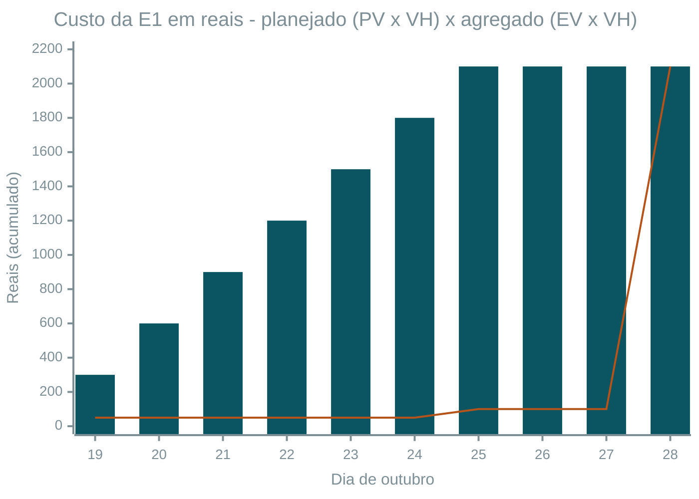

_Figura 12 - A curva do CP2 convertida em reais pelo valor-hora de referência de R$50: barras = custo planejado (PV × VH) e linha = valor entregue (EV × VH). A E1 vale **R$2.100** de esforço planejado; no vencimento havia R$100 entregues e, no ponto de controle, os R$2.100 completos. **Isto não é o CPI:** o CPI exige o custo real (`AC` = horas reais × VH) e, com o `esforco.csv` vazio, não há `AC`, então o RC2 segue não mensurável. Fonte: `linha-de-base-e1.csv` e o VH de R$50 do [plano de medição](plano-de-medicao.md)._

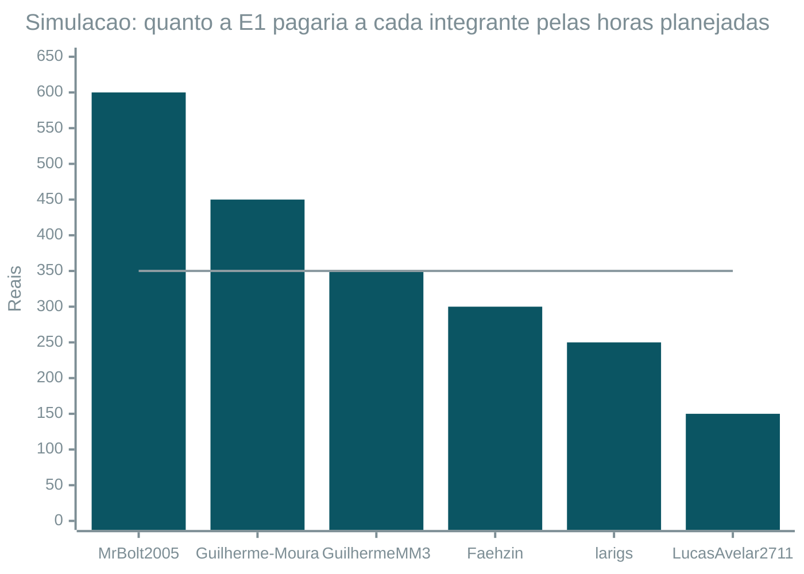

_Figura 13 - Simulação de remuneração da E1 a R$50 por hora: MrBolt2005 R$600 (12 h), Guilherme-Moura R$450 (9 h), GuilhermeMM3 R$350 (7 h), Faehzin R$300 (6 h), larigs R$250 (5 h) e LucasAvelar2711 R$150 (3 h), de um total de R$2.100._

### 4.4 Leitura do ciclo e decisões disparadas

1. **O escopo foi salvo, o prazo não.** CP1 fechou em 100% e o SPI em 1,00, mas ambos só na data de corte: no vencimento o SPI era 0,05 e a entrega saiu com 1 a 3 dias de atraso. A D03 funcionou como ação de recuperação, não como ação de prazo.
2. **O risco mudou de lado.** No ciclo 1 o problema era trabalho que entrava e não saía (razão de 0,11, WIP de 2,7 por pessoa). Agora é o contrário: nenhuma chegada, WIP zero e nenhum backlog para o ciclo seguinte. Dispara a **D10**.
3. **As duas decisões de infraestrutura de medição não saíram do papel.** D05 (horas) com 0 de 6 e D06 (PR e rastreabilidade) com 0 PRs e 0 `Closes #N`. Enquanto isso, três das dez métricas do plano (RC1, RC2 e o RC3 por horas reais) seguem não mensuráveis e os números de CP1 e CP2 dependem de declaração, não de registro. É o achado mais grave desta coleta.
4. **A causa comum é de comunicação, não de esforço.** O ponto de controle correu fora de sala, por falta de tempo em aula, e com resposta parcial da equipe. Dispara a **D09**.
5. **O remanejamento das divisões invalida a base de atribuição da E1.** A carga planejada por integrante (de 7,1% a 28,6%) não serve mais para julgar contribuição individual. Dispara a **D08**, que absorve a D07.

## 5. Próxima coleta

| Ciclo | Data | O que coletar | Situação |
|-------|------|---------------|----------|
| 2 (parcial) | Quarta-feira, 28/10/2026 | CP1, CP2, DP2 e horas retroativas dos ciclos 0 e 1 | **Realizada.** Registrada na seção 4 |
| 2 (completo) | Domingo, 01/11/2026 | Todas as métricas, incluindo o primeiro RC1, RC2 e DP4 por PR | **Pendente.** O novo ciclo não foi coletado no GitHub: em consulta de 04/11, a milestone E2 não existe, nenhuma issue foi aberta depois de 19/10, a milestone E1 continua no estado aberto e o `esforco.csv` segue vazio. Sem backlog e sem horas, a coleta completa fica limitada a DP3 e DP4 por commit (ver D10) |
| 3 (parcial) | Quarta-feira, 04/11/2026 | CP1, CP2 e DP2 da E2, mais a verificação da D08, D09 e D10 | Depende de a milestone E2 e as issues do ciclo existirem no GitHub |

## Histórico de versão

| Versão | Data | Descrição | Autor(a) | Revisor(a) |
|--------|------|-----------|----------|------------|
| 0.1 | 05/10/2026 | Criação da estrutura do documento | Gabriel Fae | - |
| 0.2 | 16/10/2026 | Reorganização da documentação por fases do processo de avaliação | Gabriel Fae | - |
| 0.3 | 25/10/2026 | Registro dos ciclos 0 (retroativo) e 1, painel de indicadores, gráficos e síntese | Gabriel Fae | - |
| 0.4 | 28/10/2026 | Coleta parcial do ciclo 2 (CP1, CP2, DP2 e horas retroativas), correção retroativa de DP3 e DP4 do ciclo 1, preenchimento de DP1 e DP2 do ciclo 1 e situação da coleta completa de 01/11 | Gabriel Fae | - |
| 0.5 | 28/10/2026 | Cinco gráficos de esforço, entrega e custo: volume por integrante no ciclo 0, horas planejadas x entregues e horas por categoria no ciclo 1, custo da E1 em reais e simulação de pagamento por integrante no ciclo 2 | Gabriel Fae | - |
