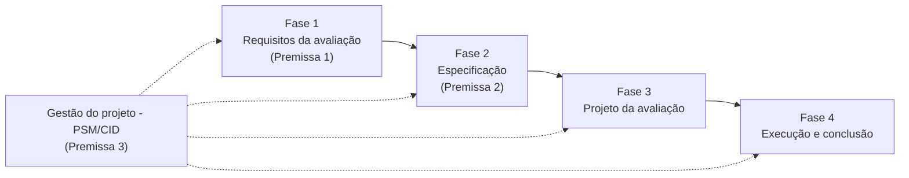

# Avaliação de Qualidade do VICKY

**FGA0315 - Qualidade de Software 1** · FCTE/UnB · 2026.2 · Turma T02 · Grupo Frances Allen

Este site documenta a **avaliação da qualidade do produto de software VICKY**, um website para **estudantes de medicina** buscarem e consultarem artigos científicos e conteúdos acadêmicos da área da saúde. Orientação: Profa. Cristiane Ramos.

## Como navegar

A barra lateral à esquerda lista todas as páginas. Os atalhos abaixo levam às seções principais.

-   Contexto

    **[O projeto](projeto/index.md)**

    ---

    Produto avaliado, acesso ao código-fonte, equipe e declaração de uso de IA.

-   Premissa 1 · Fase 1

    **[Características de qualidade](premissa-1-caracteristicas/index.md)**

    ---

    Adequação funcional, capacidade de interação e manutenibilidade (ISO/IEC 25010:2023), com a justificativa da escolha.

-   Premissa 2 · Fase 2

    **[Métricas (GQM)](premissa-2-metricas/index.md)**

    ---

    Objetivos, questões, hipóteses, fichas das métricas, níveis de pontuação e diagrama GQM.

-   Premissa 3 · Transversal

    **[Gestão do projeto (PSM/CID)](premissa-3-gestao/index.md)**

    ---

    Indicadores de calendário e progresso, recursos e custos, e desempenho dos processos, com as decisões tomadas a partir deles.

## Como a avaliação está organizada

A avaliação segue o processo de avaliação de produto da família **SQuaRE** (ISO/IEC 25040). Cada premissa obrigatória corresponde a uma fase desse processo:

| Premissa | O que define | Fase do processo |
|----------|--------------|------------------|
| [Premissa 1 - Características de qualidade](premissa-1-caracteristicas/index.md) | Adequação funcional, capacidade de interação e manutenibilidade (ISO/IEC 25010:2023) e sua justificativa | Fase 1 - Estabelecer os requisitos da avaliação |
| [Premissa 2 - Métricas (GQM)](premissa-2-metricas/index.md) | Objetivos, questões, hipóteses, métricas e critérios de julgamento | Fase 2 - Especificar a avaliação |
| [Premissa 3 - Gestão do projeto (PSM/CID)](premissa-3-gestao/index.md) | Indicadores de acompanhamento do próprio projeto e decisões de gestão | Transversal a todas as fases |

## Entregas

| Entrega | Data | Conteúdo | Release |
|---------|------|----------|---------|
| Entrega 1 | 26/10/2026 | Fases 1 e 2, 1ª versão do artigo, tabela de contribuição | _a publicar_ |
| Entrega 2 | _conforme cronograma da disciplina_ | Fases 3 e 4, ação de melhoria, 2ª versão do artigo | _a publicar_ |

## Links

- Repositório: [FCTE-Qualidade-de-Software-1/2026-2_T02_FRANCES_ALLEN](https://github.com/FCTE-Qualidade-de-Software-1/2026-2_T02_FRANCES_ALLEN)
- Releases: [página de releases](https://github.com/FCTE-Qualidade-de-Software-1/2026-2_T02_FRANCES_ALLEN/releases)
- Quadro de tarefas: _link do GitHub Projects_
- Equipe: [Integrantes e papéis](projeto/equipe.md)

## Histórico de versão

| Versão | Data | Descrição | Autor(a) | Revisor(a) |
|--------|------|-----------|----------|------------|
| 0.1 | 05/10/2026 | Criação da estrutura do documento | Gabriel Fae | - |
