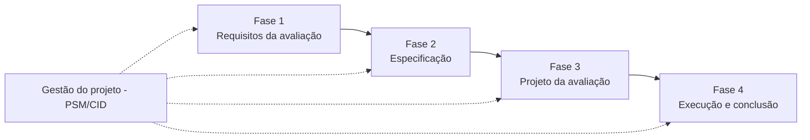

# Avaliação de Qualidade do VICKY

**FGA0315 - Qualidade de Software 1** · FCTE/UnB · 2026.2 · Turma T02 · Grupo Frances Allen

Este site documenta a **avaliação da qualidade do produto de software VICKY**, um website para **estudantes de medicina** buscarem e consultarem artigos científicos e conteúdos acadêmicos da área da saúde. Orientação: Profa. Cristiane Ramos.

## Como navegar

As abas no topo seguem as **fases do processo de avaliação de produto** da família SQuaRE (ISO/IEC 25040). A barra lateral à esquerda mostra as páginas da aba selecionada.

-   Fase 1 · Entrega 1

    **[Estabelecer os requisitos da avaliação](fase-1/index.md)**

    ---

    Propósito, partes interessadas, objeto de avaliação, modelo de qualidade, características selecionadas (adequação funcional, capacidade de interação e manutenibilidade), escopo e ODS.

-   Fase 2 · Entrega 1

    **[Especificar a avaliação](fase-2/index.md)**

    ---

    Objetivos, questões, hipóteses, fichas das métricas, níveis de pontuação, critérios de julgamento e diagrama GQM.

-   Fase 3 · Entrega 2

    **[Projetar a avaliação](fase-3/index.md)**

    ---

    Futuramente.

-   Fase 4 · Entrega 2

    **[Executar e concluir a avaliação](fase-4/index.md)**

    ---

    Futuramente.

-   Transversal

    **[Gestão do projeto (PSM/CID)](gestao/index.md)**

    ---

    Indicadores de calendário e progresso, recursos e custos, e desempenho dos processos, com as decisões tomadas a partir deles e as atas de reunião.

-   Contexto

    **[Sobre o projeto](sobre/index.md)**

    ---

    Equipe, declaração de uso de IA, identidade visual e referências.

## Como a avaliação está organizada

Cada fase do processo de avaliação recebe uma aba própria. As premissas obrigatórias da especificação do trabalho se distribuem entre elas:

| Fase do processo (ISO/IEC 25040) | O que define | Premissa atendida | Entrega |
|----------------------------------|--------------|-------------------|---------|
| [Fase 1 - Estabelecer os requisitos da avaliação](fase-1/index.md) | Propósito, partes interessadas, modelo de qualidade e características selecionadas | Premissa 1 | Entrega 1 |
| [Fase 2 - Especificar a avaliação](fase-2/index.md) | Objetivos, questões, hipóteses, métricas e critérios de julgamento (GQM) | Premissa 2 | Entrega 1 |
| [Fase 3 - Projetar a avaliação](fase-3/index.md) | Método, recursos, ambiente e cronograma da avaliação | - | Entrega 2 |
| [Fase 4 - Executar e concluir a avaliação](fase-4/index.md) | Medições, julgamento, conclusões e ação de melhoria | Premissa 1 (relações entre características) | Entrega 2 |
| [Gestão do projeto (PSM/CID)](gestao/index.md) | Indicadores de acompanhamento do próprio projeto e decisões de gestão | Premissa 3 | Transversal |

## Entregas

| Entrega | Data | Conteúdo | Release |
|---------|------|----------|---------|
| Entrega 1 | 26/10/2026 | Fases 1 e 2, 1ª versão do artigo, tabela de contribuição | _a publicar_ |
| Entrega 2 | _conforme cronograma da disciplina_ | Fases 3 e 4, ação de melhoria, 2ª versão do artigo | _a publicar_ |

## Links

- Repositório: [FCTE-Qualidade-de-Software-1/2026-2_T02_FRANCES_ALLEN](https://github.com/FCTE-Qualidade-de-Software-1/2026-2_T02_FRANCES_ALLEN)
- Releases: [página de releases](https://github.com/FCTE-Qualidade-de-Software-1/2026-2_T02_FRANCES_ALLEN/releases)
- Quadro de tarefas: _link do GitHub Projects_
- Equipe: [Integrantes e papéis](sobre/equipe.md)

## Histórico de versão

| Versão | Data | Descrição | Autor(a) | Revisor(a) |
|--------|------|-----------|----------|------------|
| 0.1 | 05/10/2026 | Criação da estrutura do documento | Gabriel Fae | - |
| 0.2 | 16/10/2026 | Reorganização da documentação em abas por fase do processo de avaliação | Gabriel Fae | - |
